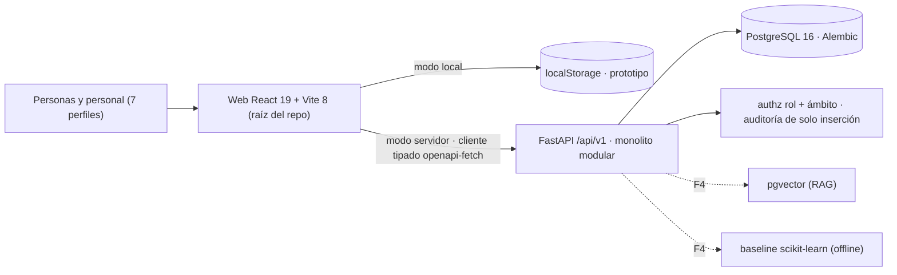
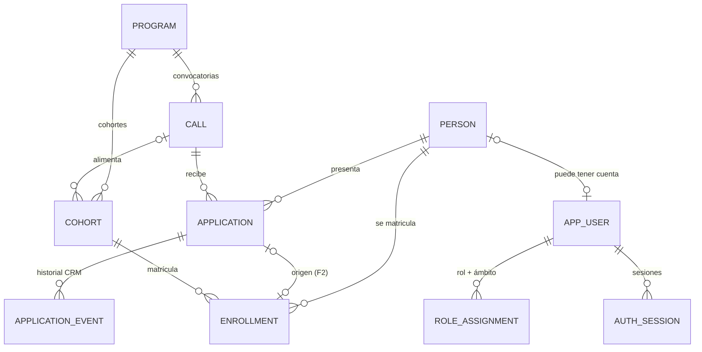

# 02 · Arquitectura y contratos compartidos

## Vista general

- **Monolito modular** (`api/app/modules/<dominio>`), un `APIRouter` por dominio: `identity`, `catalog`, `admissions`, `learning`, `audit`; F3–F4 añaden `knowledge` y `risk`. Sin microservicios.
- **Una sola base de datos** y un solo expediente por persona. PostgreSQL también en pruebas.
- **Contrato**: FastAPI genera `contracts/openapi.json` → `openapi-typescript` genera `src/shared/api/schema.gen.ts`. No se escriben DTOs a mano; CI falla si hay deriva.
- **Web en la raíz** mientras se use Figma Make (ADR-0001). Conmutador `VITE_GISTAR_API_URL` (ADR-0004).

## Modelo de datos compartido

Reglas (implementadas en F1 salvo indicación):

1. `person.email` normalizado y único → deduplicación; `application` única por (`person_id`, `call_id`).
2. Aspirante y coder son **estados** de `Person` (candidaturas / matrículas), no roles.
3. `role_assignment` = rol ∈ {admin, captacion, seleccion, docente, coordinacion} + ámbito ∈ {global, program, call, cohort}. Acumulable y revocable.
4. `application.stage` usa el vocabulario del prototipo + `retirada`; los cambios de etapa solo llegarán por revisión/decisión humana (F2), nunca por CRM ni por reglas.
5. `audit_event` de solo inserción (trigger PostgreSQL); metadatos con identificadores y códigos, sin nombres, correos ni texto libre.
6. Pendiente F2: `RequirementReview`, `ScoreRubricVersion`, `AssessmentScore`, `AdmissionDecision` (firmantes + justificación), `WaitlistEntry`. F3: persistir competencias/rúbricas/evaluaciones existentes. F4: `KnowledgeDocument/Chunk`, `FeedbackDraft`, `RiskSignal/Alert`, `Intervention`.

## Autorización

- Sesión con **token opaco** (`secrets.token_urlsafe`), solo se guarda su SHA-256, caduca (8 h) y se revoca por sesión (ADR-0003). Contraseñas `scrypt`.
- `Principal.can(permiso, Scope(program, call, cohort))` en cada endpoint; los listados filtran en SQL por los ámbitos concedidos.
- Permisos F1: `admin` = todo; `captacion`/`seleccion` = `applications.read`, `applications.crm`, `calls.aggregate`; `coordinacion` = `calls.aggregate`; `docente` = ninguno en admisión (académicos en F3).
- Minimización: el recibo de inscripción no devuelve datos personales; la persona aspirante solo ve `ApplicationSelfView` (sin notas internas); Coordinación recibe agregados con supresión (N < 5 o celdas < 3).

## Contratos API

| Método y ruta | Acceso | Estado |
|---|---|---|
| `POST /api/v1/auth/login` · `GET /auth/me` · `POST /auth/logout` | cuentas sintéticas | **F1** |
| `GET /api/v1/calls?estado=` | público (solo oferta) | **F1** |
| `GET /api/v1/calls/{id}/summary` | `calls.aggregate` en ámbito | **F1** |
| `POST /api/v1/applications` | público / aspirante | **F1** |
| `GET /api/v1/applications` · `GET /applications/{id}` | `applications.read` en ámbito | **F1** |
| `POST /api/v1/applications/{id}/events` | `applications.crm` en ámbito | **F1** |
| `GET /api/v1/me/applications` | la propia persona | **F1** |
| `GET /api/v1/audit-events` | admin | **F1** |
| `POST /applications/{id}/reviews` · `/decisions` · `POST /enrollments` | selección + decisión conjunta | F2 |
| `GET /cohorts/{id}/competencies` · `POST /enrollments/{id}/assessments` · `GET /cohorts/{id}/overview` | docente de la cohorte | F3 |
| `POST /assistant/ask` · `POST /submissions/{id}/feedback-draft` · `GET /cohorts/{id}/risk-alerts` | por ámbito | F4 |

**Definition of Done por endpoint:** esquema Pydantic, autorización con ámbito, prueba happy-path, **prueba de denegación**, auditoría si escribe o lee expedientes, contrato regenerado, revisión de PR.
