# ERD y diccionario de datos / ERD and data dictionary

Generado desde los modelos SQLAlchemy registrados en [app/models.py](../../api/app/models.py). No consulta bases de datos.
Generated from registered SQLAlchemy metadata. No database connection or live-schema verification occurs.

Estado / Status: **CODE_PRESENT_NOT_RUN** para la correspondencia con una base desplegada / for deployed-schema parity.
Regenerar desde `api`: `GISTAR_ENVIRONMENT=local python scripts/export_schema_reference.py`; comprobar con `--check`.
PowerShell: establecer `$env:GISTAR_ENVIRONMENT='local'` antes del mismo comando / set the environment before running it.

## Relaciones / Relationships

Solo claves foráneas declaradas, sin inferir permisos ni transiciones. / Declared foreign keys only, not permissions or transitions.
Los marcadores muestran nulabilidad y unicidad simple; no inferir restricciones de negocio compuestas. / Markers describe nullability and single-column uniqueness, not composite business constraints.

```mermaid
erDiagram
    access_change_request {
        string id PK
    }
    app_user {
        string id PK
    }
    application {
        string id PK
    }
    application_event {
        string id PK
    }
    assignment {
        string id PK
    }
    attendance_record {
        string id PK
    }
    attendance_record_revision {
        string id PK
    }
    attendance_session {
        string id PK
    }
    audit_event {
        string id PK
    }
    auth_session {
        string id PK
    }
    automation_execution {
        string id PK
    }
    call {
        string id PK
    }
    call_requirement {
        string id PK
    }
    cohort {
        string id PK
    }
    cohort_competency_framework {
        string cohort_id PK
    }
    competency {
        string id PK
    }
    competency_assessment {
        string id PK
    }
    competency_framework {
        string id PK
    }
    discussion_comment {
        string id PK
    }
    discussion_thread {
        string id PK
    }
    enrollment {
        string id PK
    }
    intervention {
        string id PK
    }
    knowledge_chunk {
        string id PK
    }
    knowledge_document {
        string id PK
    }
    person {
        string id PK
    }
    preselection_decision {
        string id PK
    }
    program {
        string id PK
    }
    requirement_review {
        string id PK
    }
    requirement_review_revision {
        string id PK
    }
    risk_alert {
        string id PK
    }
    role_assignment {
        string id PK
    }
    selection_approval {
        string id PK
    }
    selection_decision {
        string id PK
    }
    simulated_reminder {
        string id PK
    }
    staff_invitation {
        string id PK
    }
    staff_profile {
        string id PK
    }
    submission {
        string id PK
    }
    role_assignment |o--o{ access_change_request : applied_assignment_id
    app_user ||--o{ access_change_request : requested_by
    app_user |o--o{ access_change_request : reviewed_by
    staff_profile ||--o{ access_change_request : staff_profile_id
    person |o--o| app_user : person_id
    call ||--o{ application : call_id
    person ||--o{ application : person_id
    app_user |o--o{ application_event : actor_user_id
    application ||--o{ application_event : application_id
    cohort ||--o{ assignment : cohort_id
    app_user ||--o{ assignment : created_by
    enrollment ||--o{ attendance_record : enrollment_id
    app_user ||--o{ attendance_record : recorded_by
    attendance_session ||--o{ attendance_record : session_id
    app_user ||--o{ attendance_record_revision : changed_by
    attendance_record ||--o{ attendance_record_revision : record_id
    cohort ||--o{ attendance_session : cohort_id
    app_user ||--o{ attendance_session : created_by
    app_user |o--o{ audit_event : actor_user_id
    app_user ||--o{ auth_session : user_id
    application ||--o{ automation_execution : application_id
    call ||--o{ automation_execution : call_id
    app_user ||--o{ automation_execution : recorded_by
    program ||--o{ call : program_id
    call ||--o{ call_requirement : call_id
    app_user ||--o{ call_requirement : created_by
    call |o--o{ cohort : call_id
    program ||--o{ cohort : program_id
    app_user ||--o{ cohort_competency_framework : assigned_by
    cohort ||--o| cohort_competency_framework : cohort_id
    competency_framework ||--o{ cohort_competency_framework : framework_id
    competency_framework ||--o{ competency : framework_id
    app_user ||--o{ competency_assessment : assessed_by
    competency ||--o{ competency_assessment : competency_id
    enrollment ||--o{ competency_assessment : enrollment_id
    competency_framework |o--o{ competency_framework : based_on_id
    app_user ||--o{ competency_framework : created_by
    program ||--o{ competency_framework : program_id
    app_user ||--o{ discussion_comment : actor_user_id
    app_user |o--o{ discussion_comment : deleted_by
    discussion_comment |o--o{ discussion_comment : parent_id
    discussion_comment ||--o{ discussion_comment : thread_id
    discussion_thread ||--o{ discussion_comment : thread_id
    application |o--o{ discussion_thread : application_id
    app_user ||--o{ discussion_thread : created_by
    program |o--o{ discussion_thread : program_id
    app_user |o--o{ discussion_thread : resolved_by
    application |o--o{ enrollment : application_id
    cohort ||--o{ enrollment : cohort_id
    person ||--o{ enrollment : person_id
    app_user ||--o{ intervention : actor_user_id
    risk_alert ||--o{ intervention : alert_id
    knowledge_document ||--o{ knowledge_chunk : document_id
    app_user ||--o{ preselection_decision : actor_user_id
    application ||--o{ preselection_decision : application_id
    application ||--o{ requirement_review : application_id
    call_requirement |o--o{ requirement_review : requirement_definition_id
    app_user |o--o{ requirement_review : reviewer_user_id
    call_requirement |o--o{ requirement_review_revision : requirement_definition_id
    requirement_review ||--o{ requirement_review_revision : review_id
    app_user ||--o{ requirement_review_revision : reviewer_user_id
    app_user |o--o{ risk_alert : assigned_to
    enrollment ||--o{ risk_alert : enrollment_id
    app_user |o--o{ role_assignment : granted_by
    app_user ||--o{ role_assignment : user_id
    app_user ||--o{ selection_approval : actor_user_id
    application ||--o{ selection_approval : application_id
    cohort |o--o{ selection_approval : cohort_id
    selection_decision |o--o{ selection_approval : decision_id
    app_user ||--o{ selection_decision : actor_user_id
    application ||--o{ selection_decision : application_id
    cohort |o--o{ selection_decision : cohort_id
    enrollment |o--o{ selection_decision : enrollment_id
    application ||--o{ simulated_reminder : application_id
    call ||--o{ simulated_reminder : call_id
    app_user ||--o{ simulated_reminder : recorded_by
    app_user ||--o{ staff_invitation : created_by
    staff_profile ||--o{ staff_invitation : staff_profile_id
    app_user ||--o{ staff_profile : created_by
    app_user ||--o| staff_profile : user_id
    assignment ||--o{ submission : assignment_id
    enrollment ||--o{ submission : enrollment_id
    app_user ||--o{ submission : recorded_by
    app_user |o--o{ submission : reviewed_by
```

## Campos y estados almacenados / Fields and stored states

Las restricciones CHECK conservan el vocabulario real de estados. Las reglas de transición y autorización viven en servicios y routers, no en este diagrama.
CHECK constraints preserve the stored state vocabulary. Transition/authorization rules live in services and routers, not this diagram.

### access_change_request

| Campo / Field | PostgreSQL type | Nulo / Nullable | Referencia / Reference |
|---|---|---|---|
| id | UUID | no | — |
| staff_profile_id | UUID | no | staff_profile.id |
| requested_role | VARCHAR(20) | no | — |
| scope_type | VARCHAR(12) | no | — |
| scope_id | VARCHAR(30) | sí / yes | — |
| state | VARCHAR(12) | no | — |
| requested_by | UUID | no | app_user.id |
| requested_at | TIMESTAMP WITH TIME ZONE | no | — |
| reviewed_by | UUID | sí / yes | app_user.id |
| reviewed_at | TIMESTAMP WITH TIME ZONE | sí / yes | — |
| applied_assignment_id | UUID | sí / yes | role_assignment.id |

- CHECK `ck_access_request_distinct_reviewer`: `reviewed_by IS NULL OR reviewed_by <> requested_by`

- CHECK `ck_access_request_review_shape`: `(state = 'requested' AND reviewed_by IS NULL AND reviewed_at IS NULL AND applied_assignment_id IS NULL) OR (state IN ('approved', 'rejected') AND reviewed_by IS NOT NULL AND reviewed_at IS NOT NULL AND applied_assignment_id IS NULL) OR (state IN ('applied', 'revoked') AND reviewed_by IS NOT NULL AND reviewed_at IS NOT NULL AND applied_assignment_id IS NOT NULL)`

- CHECK `ck_access_request_role`: `requested_role IN ('admin', 'captacion', 'seleccion', 'docente', 'coordinacion')`

- CHECK `ck_access_request_scope`: `scope_type IN ('global', 'program', 'call', 'cohort')`

- CHECK `ck_access_request_scope_id`: `(scope_type = 'global') = (scope_id IS NULL)`

- CHECK `ck_access_request_state`: `state IN ('requested', 'approved', 'rejected', 'applied', 'revoked')`

### app_user

| Campo / Field | PostgreSQL type | Nulo / Nullable | Referencia / Reference |
|---|---|---|---|
| id | UUID | no | — |
| email | VARCHAR(254) | no | — |
| display_name | VARCHAR(120) | no | — |
| password_hash | VARCHAR(200) | no | — |
| person_id | UUID | sí / yes | person.id |
| is_active | BOOLEAN | no | — |
| created_at | TIMESTAMP WITH TIME ZONE | no | — |

- UNIQUE `unnamed`: `person_id`

### application

| Campo / Field | PostgreSQL type | Nulo / Nullable | Referencia / Reference |
|---|---|---|---|
| id | UUID | no | — |
| codigo | VARCHAR(20) | no | — |
| legacy_ref | VARCHAR(20) | sí / yes | — |
| person_id | UUID | no | person.id |
| call_id | VARCHAR(30) | no | call.id |
| stage | VARCHAR(40) | no | — |
| motivacion | TEXT | no | — |
| disponibilidad | VARCHAR(20) | no | — |
| acepta_datos_sinteticos | BOOLEAN | no | — |
| created_at | TIMESTAMP WITH TIME ZONE | no | — |
| updated_at | TIMESTAMP WITH TIME ZONE | no | — |

- CHECK `ck_application_stage`: `stage IN ('enviada', 'requisitos_en_revision', 'convocada', 'evaluacion_en_curso', 'pendiente_decision_humana', 'admitida', 'lista_espera', 'no_admitida', 'retirada')`

- UNIQUE `unnamed`: `codigo`

- UNIQUE `unnamed`: `legacy_ref`

- UNIQUE `uq_application_person_call`: `person_id, call_id`

### application_event

| Campo / Field | PostgreSQL type | Nulo / Nullable | Referencia / Reference |
|---|---|---|---|
| id | UUID | no | — |
| application_id | UUID | no | application.id |
| tipo | VARCHAR(20) | no | — |
| canal | VARCHAR(20) | sí / yes | — |
| resultado | VARCHAR(20) | sí / yes | — |
| resumen | VARCHAR(500) | no | — |
| actor_user_id | UUID | sí / yes | app_user.id |
| occurred_at | TIMESTAMP WITH TIME ZONE | no | — |

- CHECK `ck_application_event_canal`: `canal IS NULL OR canal IN ('email', 'telefono', 'presencial', 'videollamada')`

- CHECK `ck_application_event_resultado`: `resultado IS NULL OR (tipo = 'contacto' AND resultado IN ('respondida', 'sin_respuesta'))`

- CHECK `ck_application_event_tipo`: `tipo IN ('creada', 'contacto', 'nota', 'recordatorio', 'cambio_etapa')`

### assignment

| Campo / Field | PostgreSQL type | Nulo / Nullable | Referencia / Reference |
|---|---|---|---|
| id | UUID | no | — |
| cohort_id | VARCHAR(20) | no | cohort.id |
| legacy_ref | VARCHAR(40) | sí / yes | — |
| title | VARCHAR(160) | no | — |
| description | TEXT | no | — |
| due_at | TIMESTAMP WITH TIME ZONE | no | — |
| rubric | JSON | no | — |
| status | VARCHAR(10) | no | — |
| created_by | UUID | no | app_user.id |
| created_at | TIMESTAMP WITH TIME ZONE | no | — |

- CHECK `ck_assignment_status`: `status IN ('draft', 'published')`

### attendance_record

| Campo / Field | PostgreSQL type | Nulo / Nullable | Referencia / Reference |
|---|---|---|---|
| id | UUID | no | — |
| session_id | UUID | no | attendance_session.id |
| enrollment_id | UUID | no | enrollment.id |
| status | VARCHAR(10) | no | — |
| modality | VARCHAR(10) | sí / yes | — |
| justification | VARCHAR(15) | sí / yes | — |
| version | INTEGER | no | — |
| recorded_by | UUID | no | app_user.id |
| updated_at | TIMESTAMP WITH TIME ZONE | no | — |

- CHECK `ck_attendance_record_justification`: `justification IS NULL OR justification IN ('justificada', 'no_justificada')`

- CHECK `ck_attendance_record_modality`: `modality IS NULL OR modality IN ('presencial', 'online')`

- CHECK `ck_attendance_record_shape`: `(status IN ('presente', 'retraso') AND modality IS NOT NULL AND justification IS NULL) OR (status = 'ausente' AND modality IS NULL AND justification IS NOT NULL)`

- CHECK `ck_attendance_record_status`: `status IN ('presente', 'retraso', 'ausente')`

- UNIQUE `uq_attendance_record_session_enrollment`: `session_id, enrollment_id`

### attendance_record_revision

| Campo / Field | PostgreSQL type | Nulo / Nullable | Referencia / Reference |
|---|---|---|---|
| id | UUID | no | — |
| record_id | UUID | no | attendance_record.id |
| version | INTEGER | no | — |
| status | VARCHAR(10) | no | — |
| modality | VARCHAR(10) | sí / yes | — |
| justification | VARCHAR(15) | sí / yes | — |
| reason | VARCHAR(300) | sí / yes | — |
| changed_by | UUID | no | app_user.id |
| changed_at | TIMESTAMP WITH TIME ZONE | no | — |

- CHECK `ck_attendance_record_revision_reason`: `version = 1 OR length(btrim(coalesce(reason, ''))) > 0`

- CHECK `ck_attendance_record_revision_shape`: `(status IN ('presente', 'retraso') AND modality IS NOT NULL AND justification IS NULL) OR (status = 'ausente' AND modality IS NULL AND justification IS NOT NULL)`

- UNIQUE `uq_attendance_record_revision_version`: `record_id, version`

### attendance_session

| Campo / Field | PostgreSQL type | Nulo / Nullable | Referencia / Reference |
|---|---|---|---|
| id | UUID | no | — |
| cohort_id | VARCHAR(20) | no | cohort.id |
| session_date | DATE | no | — |
| shift | VARCHAR(10) | no | — |
| duration_fraction | NUMERIC(2, 1) | no | — |
| created_by | UUID | no | app_user.id |
| created_at | TIMESTAMP WITH TIME ZONE | no | — |

- CHECK `ck_attendance_session_fraction`: `(shift = 'completa' AND duration_fraction = 1) OR (shift IN ('manana','tarde') AND duration_fraction = 0.5)`

- CHECK `ck_attendance_session_shift`: `shift IN ('manana', 'tarde', 'completa')`

- UNIQUE `uq_attendance_session_slot`: `cohort_id, session_date, shift`

### audit_event

| Campo / Field | PostgreSQL type | Nulo / Nullable | Referencia / Reference |
|---|---|---|---|
| id | BIGINT | no | — |
| at | TIMESTAMP WITH TIME ZONE | no | — |
| actor_user_id | UUID | sí / yes | app_user.id |
| actor_roles | VARCHAR(200) | no | — |
| action | VARCHAR(60) | no | — |
| target_type | VARCHAR(40) | no | — |
| target_id | VARCHAR(60) | sí / yes | — |
| meta | JSON | no | — |

### auth_session

| Campo / Field | PostgreSQL type | Nulo / Nullable | Referencia / Reference |
|---|---|---|---|
| id | UUID | no | — |
| user_id | UUID | no | app_user.id |
| token_hash | VARCHAR(64) | no | — |
| created_at | TIMESTAMP WITH TIME ZONE | no | — |
| expires_at | TIMESTAMP WITH TIME ZONE | no | — |
| revoked_at | TIMESTAMP WITH TIME ZONE | sí / yes | — |

- UNIQUE `unnamed`: `token_hash`

### automation_execution

| Campo / Field | PostgreSQL type | Nulo / Nullable | Referencia / Reference |
|---|---|---|---|
| id | UUID | no | — |
| application_id | UUID | no | application.id |
| call_id | VARCHAR(30) | no | call.id |
| kind | VARCHAR(40) | no | — |
| rule_version | VARCHAR(40) | no | — |
| idempotency_key | VARCHAR(64) | no | — |
| outcome | VARCHAR(20) | no | — |
| stage_at_evaluation | VARCHAR(40) | no | — |
| snapshot | JSONB | no | — |
| recorded_by | UUID | no | app_user.id |
| evaluated_at | TIMESTAMP WITH TIME ZONE | no | — |

- CHECK `ck_automation_execution_kind`: `kind = 'requirement_prefilter'`

- CHECK `ck_automation_execution_outcome`: `outcome IN ('human_review', 'no_action')`

- UNIQUE `uq_automation_execution_key`: `idempotency_key`

### call

| Campo / Field | PostgreSQL type | Nulo / Nullable | Referencia / Reference |
|---|---|---|---|
| id | VARCHAR(30) | no | — |
| program_id | VARCHAR(20) | no | program.id |
| nombre | VARCHAR(160) | no | — |
| codigo_prefix | VARCHAR(10) | no | — |
| opens_on | DATE | no | — |
| closes_on | DATE | no | — |
| plazas | INTEGER | no | — |
| estado | VARCHAR(10) | no | — |
| next_seq | INTEGER | no | — |
| silence_days | INTEGER | no | — |
| silence_max_contacts | INTEGER | no | — |
| silence_warning_contacts | INTEGER | no | — |
| selection_quorum | INTEGER | no | — |

- CHECK `ck_call_estado`: `estado IN ('abierta','cerrada')`

- CHECK `ck_call_selection_quorum`: `selection_quorum BETWEEN 1 AND 5`

- CHECK `ck_call_silence_days`: `silence_days BETWEEN 1 AND 365`

- CHECK `ck_call_silence_max_contacts`: `silence_max_contacts BETWEEN 1 AND 20`

- CHECK `ck_call_silence_warning_contacts`: `silence_warning_contacts BETWEEN 1 AND silence_max_contacts`

- UNIQUE `unnamed`: `codigo_prefix`

### call_requirement

| Campo / Field | PostgreSQL type | Nulo / Nullable | Referencia / Reference |
|---|---|---|---|
| id | UUID | no | — |
| call_id | VARCHAR(30) | no | call.id |
| ref | VARCHAR(60) | no | — |
| code | VARCHAR(60) | no | — |
| version | INTEGER | no | — |
| label | VARCHAR(200) | no | — |
| kind | VARCHAR(20) | no | — |
| funder | VARCHAR(120) | sí / yes | — |
| created_by | UUID | no | app_user.id |
| created_at | TIMESTAMP WITH TIME ZONE | no | — |

- CHECK `ck_call_requirement_kind`: `kind IN ('required', 'recommended')`

- CHECK `ck_call_requirement_version`: `version >= 1`

- UNIQUE `uq_call_requirement_code_version`: `call_id, code, version`

- UNIQUE `uq_call_requirement_ref`: `call_id, ref`

### cohort

| Campo / Field | PostgreSQL type | Nulo / Nullable | Referencia / Reference |
|---|---|---|---|
| id | VARCHAR(20) | no | — |
| program_id | VARCHAR(20) | no | program.id |
| call_id | VARCHAR(30) | sí / yes | call.id |
| nombre | VARCHAR(160) | no | — |
| inicio | DATE | no | — |
| fin | DATE | no | — |
| timezone | VARCHAR(40) | no | — |

- CHECK `ck_cohort_timezone`: `timezone IN ('Europe/Madrid', 'Atlantic/Canary', 'Europe/Lisbon')`

### cohort_competency_framework

| Campo / Field | PostgreSQL type | Nulo / Nullable | Referencia / Reference |
|---|---|---|---|
| cohort_id | VARCHAR(20) | no | cohort.id |
| framework_id | UUID | no | competency_framework.id |
| assigned_by | UUID | no | app_user.id |
| assigned_at | TIMESTAMP WITH TIME ZONE | no | — |

### competency

| Campo / Field | PostgreSQL type | Nulo / Nullable | Referencia / Reference |
|---|---|---|---|
| id | UUID | no | — |
| framework_id | UUID | no | competency_framework.id |
| codigo | VARCHAR(4) | no | — |
| nombre | VARCHAR(160) | no | — |
| descripcion | TEXT | no | — |
| level_1 | TEXT | no | — |
| level_2 | TEXT | no | — |
| level_3 | TEXT | no | — |
| orden | INTEGER | no | — |

- CHECK `ck_competency_codigo`: `codigo ~ '^C[1-9][0-9]?$'`

- UNIQUE `uq_competency_framework_codigo`: `framework_id, codigo`

### competency_assessment

| Campo / Field | PostgreSQL type | Nulo / Nullable | Referencia / Reference |
|---|---|---|---|
| id | UUID | no | — |
| enrollment_id | UUID | no | enrollment.id |
| competency_id | UUID | no | competency.id |
| level | SMALLINT | no | — |
| evidence | VARCHAR(500) | no | — |
| assessed_by | UUID | no | app_user.id |
| assessed_at | TIMESTAMP WITH TIME ZONE | no | — |

- CHECK `ck_competency_assessment_evidence`: `length(btrim(evidence)) > 0`

- CHECK `ck_competency_assessment_level`: `level BETWEEN 1 AND 3`

### competency_framework

| Campo / Field | PostgreSQL type | Nulo / Nullable | Referencia / Reference |
|---|---|---|---|
| id | UUID | no | — |
| program_id | VARCHAR(20) | no | program.id |
| version | INTEGER | no | — |
| estado | VARCHAR(10) | no | — |
| based_on_id | UUID | sí / yes | competency_framework.id |
| created_by | UUID | no | app_user.id |
| created_at | TIMESTAMP WITH TIME ZONE | no | — |
| published_at | TIMESTAMP WITH TIME ZONE | sí / yes | — |

- CHECK `ck_competency_framework_estado`: `estado IN ('borrador', 'publicada', 'archivada')`

- CHECK `ck_competency_framework_published_at`: `(estado = 'borrador') = (published_at IS NULL)`

- CHECK `ck_competency_framework_version`: `version >= 1`

- UNIQUE `uq_competency_framework_version`: `program_id, version`

### discussion_comment

| Campo / Field | PostgreSQL type | Nulo / Nullable | Referencia / Reference |
|---|---|---|---|
| id | UUID | no | — |
| thread_id | UUID | no | discussion_comment.thread_id, discussion_thread.id |
| parent_id | UUID | sí / yes | discussion_comment.id |
| actor_user_id | UUID | no | app_user.id |
| body | VARCHAR(2000) | no | — |
| version | INTEGER | no | — |
| created_at | TIMESTAMP WITH TIME ZONE | no | — |
| edited_at | TIMESTAMP WITH TIME ZONE | sí / yes | — |
| deleted_by | UUID | sí / yes | app_user.id |
| deleted_at | TIMESTAMP WITH TIME ZONE | sí / yes | — |

- CHECK `ck_discussion_comment_body`: `length(trim(body)) BETWEEN 1 AND 2000`

- CHECK `ck_discussion_comment_deleted`: `(deleted_by IS NULL) = (deleted_at IS NULL)`

- CHECK `ck_discussion_comment_edited`: `edited_at IS NULL OR edited_at >= created_at`

- CHECK `ck_discussion_comment_not_self`: `parent_id IS NULL OR parent_id <> id`

- CHECK `ck_discussion_comment_version`: `version >= 1`

- UNIQUE `uq_discussion_comment_thread_id`: `thread_id, id`

### discussion_thread

| Campo / Field | PostgreSQL type | Nulo / Nullable | Referencia / Reference |
|---|---|---|---|
| id | UUID | no | — |
| scope_type | VARCHAR(12) | no | — |
| application_id | UUID | sí / yes | application.id |
| program_id | VARCHAR(20) | sí / yes | program.id |
| subject | VARCHAR(160) | no | — |
| created_by | UUID | no | app_user.id |
| created_at | TIMESTAMP WITH TIME ZONE | no | — |
| resolved_by | UUID | sí / yes | app_user.id |
| resolved_at | TIMESTAMP WITH TIME ZONE | sí / yes | — |
| version | INTEGER | no | — |

- CHECK `ck_discussion_thread_resolution`: `(resolved_by IS NULL) = (resolved_at IS NULL)`

- CHECK `ck_discussion_thread_scope`: `(scope_type = 'application' AND application_id IS NOT NULL AND program_id IS NULL) OR (scope_type = 'program' AND program_id IS NOT NULL AND application_id IS NULL)`

- CHECK `ck_discussion_thread_subject`: `length(trim(subject)) BETWEEN 1 AND 160`

- CHECK `ck_discussion_thread_version`: `version >= 1`

### enrollment

| Campo / Field | PostgreSQL type | Nulo / Nullable | Referencia / Reference |
|---|---|---|---|
| id | UUID | no | — |
| person_id | UUID | no | person.id |
| cohort_id | VARCHAR(20) | no | cohort.id |
| application_id | UUID | sí / yes | application.id |
| estado | VARCHAR(20) | no | — |
| created_at | TIMESTAMP WITH TIME ZONE | no | — |

- CHECK `ck_enrollment_estado`: `estado IN ('activa','finalizada','baja_voluntaria')`

- UNIQUE `uq_enrollment_person_cohort`: `person_id, cohort_id`

### intervention

| Campo / Field | PostgreSQL type | Nulo / Nullable | Referencia / Reference |
|---|---|---|---|
| id | UUID | no | — |
| alert_id | UUID | no | risk_alert.id |
| actor_user_id | UUID | no | app_user.id |
| kind | VARCHAR(12) | no | — |
| note | VARCHAR(500) | no | — |
| occurred_at | TIMESTAMP WITH TIME ZONE | no | — |

- CHECK `ck_intervention_kind`: `kind IN ('contact', 'support', 'closure')`

- CHECK `ck_intervention_note`: `length(trim(note)) BETWEEN 1 AND 500`

### knowledge_chunk

| Campo / Field | PostgreSQL type | Nulo / Nullable | Referencia / Reference |
|---|---|---|---|
| id | UUID | no | — |
| document_id | UUID | no | knowledge_document.id |
| ordinal | INTEGER | no | — |
| text | TEXT | no | — |
| embedding | VECTOR(768) | sí / yes | — |
| embedding_model | VARCHAR(60) | sí / yes | — |
| created_at | TIMESTAMP WITH TIME ZONE | no | — |

- CHECK `ck_knowledge_chunk_embedding_model`: `(embedding IS NULL) = (embedding_model IS NULL)`

- CHECK `ck_knowledge_chunk_ordinal`: `ordinal >= 0`

- UNIQUE `uq_knowledge_chunk_document_ordinal`: `document_id, ordinal`

### knowledge_document

| Campo / Field | PostgreSQL type | Nulo / Nullable | Referencia / Reference |
|---|---|---|---|
| id | UUID | no | — |
| source_key | VARCHAR(100) | no | — |
| title | VARCHAR(200) | no | — |
| version | VARCHAR(20) | no | — |
| scope_type | VARCHAR(10) | no | — |
| scope_id | VARCHAR(30) | no | — |
| valid_from | DATE | no | — |
| valid_until | DATE | sí / yes | — |
| status | VARCHAR(10) | no | — |
| content_hash | VARCHAR(64) | no | — |
| is_synthetic | BOOLEAN | no | — |
| created_at | TIMESTAMP WITH TIME ZONE | no | — |
| updated_at | TIMESTAMP WITH TIME ZONE | no | — |

- CHECK `ck_knowledge_document_scope_type`: `scope_type IN ('program', 'call', 'cohort')`

- CHECK `ck_knowledge_document_status`: `status IN ('vigente', 'obsoleto')`

- CHECK `ck_knowledge_document_validity`: `valid_until IS NULL OR valid_until >= valid_from`

- UNIQUE `uq_knowledge_document_source_version`: `source_key, version`

### person

| Campo / Field | PostgreSQL type | Nulo / Nullable | Referencia / Reference |
|---|---|---|---|
| id | UUID | no | — |
| display_name | VARCHAR(120) | no | — |
| email | VARCHAR(254) | no | — |
| legacy_ref | VARCHAR(20) | sí / yes | — |
| is_synthetic | BOOLEAN | no | — |
| created_at | TIMESTAMP WITH TIME ZONE | no | — |

- UNIQUE `unnamed`: `legacy_ref`

### preselection_decision

| Campo / Field | PostgreSQL type | Nulo / Nullable | Referencia / Reference |
|---|---|---|---|
| id | UUID | no | — |
| application_id | UUID | no | application.id |
| decision | VARCHAR(30) | no | — |
| from_stage | VARCHAR(40) | no | — |
| to_stage | VARCHAR(40) | no | — |
| reason | VARCHAR(500) | no | — |
| actor_user_id | UUID | no | app_user.id |
| occurred_at | TIMESTAMP WITH TIME ZONE | no | — |
| evidence | JSON | no | — |

- CHECK `ck_preselection_decision_decision`: `decision IN ('convocada', 'retirada_expresa', 'silencio_confirmado', 'silencio_reprogramado')`

- CHECK `ck_preselection_decision_reason`: `length(btrim(reason)) > 0`

- CHECK `ck_preselection_decision_stages`: `from_stage IN ('enviada', 'requisitos_en_revision', 'convocada', 'evaluacion_en_curso', 'pendiente_decision_humana', 'admitida', 'lista_espera', 'no_admitida', 'retirada') AND to_stage IN ('enviada', 'requisitos_en_revision', 'convocada', 'evaluacion_en_curso', 'pendiente_decision_humana', 'admitida', 'lista_espera', 'no_admitida', 'retirada')`

### program

| Campo / Field | PostgreSQL type | Nulo / Nullable | Referencia / Reference |
|---|---|---|---|
| id | VARCHAR(20) | no | — |
| nombre | VARCHAR(120) | no | — |
| descripcion | TEXT | no | — |

### requirement_review

| Campo / Field | PostgreSQL type | Nulo / Nullable | Referencia / Reference |
|---|---|---|---|
| id | UUID | no | — |
| application_id | UUID | no | application.id |
| requirement_ref | VARCHAR(60) | no | — |
| requirement_definition_id | UUID | sí / yes | call_requirement.id |
| result | VARCHAR(30) | no | — |
| reviewer_user_id | UUID | sí / yes | app_user.id |
| reviewed_at | TIMESTAMP WITH TIME ZONE | sí / yes | — |
| reason | VARCHAR(500) | sí / yes | — |
| version | INTEGER | no | — |
| created_at | TIMESTAMP WITH TIME ZONE | no | — |

- CHECK `ck_requirement_review_completed`: `(result = 'pending' AND reviewer_user_id IS NULL AND reviewed_at IS NULL AND reason IS NULL) OR (result <> 'pending' AND reviewer_user_id IS NOT NULL AND reviewed_at IS NOT NULL AND reason IS NOT NULL AND length(btrim(reason)) > 0)`

- CHECK `ck_requirement_review_result`: `result IN ('pending', 'met', 'not_met', 'exception_under_review', 'exception_approved')`

- UNIQUE `uq_requirement_review_application_ref`: `application_id, requirement_ref`

### requirement_review_revision

| Campo / Field | PostgreSQL type | Nulo / Nullable | Referencia / Reference |
|---|---|---|---|
| id | UUID | no | — |
| review_id | UUID | no | requirement_review.id |
| requirement_definition_id | UUID | sí / yes | call_requirement.id |
| revision | INTEGER | no | — |
| result | VARCHAR(30) | no | — |
| reviewer_user_id | UUID | no | app_user.id |
| reviewed_at | TIMESTAMP WITH TIME ZONE | no | — |
| reason | VARCHAR(500) | no | — |

- CHECK `ck_requirement_review_revision_reason`: `length(btrim(reason)) > 0`

- CHECK `ck_requirement_review_revision_result`: `result IN ('met', 'not_met', 'exception_under_review', 'exception_approved')`

- UNIQUE `uq_requirement_review_revision_number`: `review_id, revision`

### risk_alert

| Campo / Field | PostgreSQL type | Nulo / Nullable | Referencia / Reference |
|---|---|---|---|
| id | UUID | no | — |
| enrollment_id | UUID | no | enrollment.id |
| model_version | VARCHAR(80) | no | — |
| model_hash | VARCHAR(64) | no | — |
| cutoff | DATE | no | — |
| status | VARCHAR(12) | no | — |
| synthetic_proxy_score | NUMERIC(8, 7) | sí / yes | — |
| experimental_support_signal | BOOLEAN | sí / yes | — |
| abstention_reason | VARCHAR(120) | sí / yes | — |
| unjustified_absence_days | NUMERIC(10, 2) | sí / yes | — |
| justified_absence_days | NUMERIC(10, 2) | sí / yes | — |
| attendance_unknown_fraction | NUMERIC(8, 7) | sí / yes | — |
| mean_competency_level | NUMERIC(4, 2) | sí / yes | — |
| synthetic_only | BOOLEAN | no | — |
| human_review_only | BOOLEAN | no | — |
| validated_for_people | BOOLEAN | no | — |
| review_state | VARCHAR(12) | no | — |
| assigned_to | UUID | sí / yes | app_user.id |
| created_at | TIMESTAMP WITH TIME ZONE | no | — |

- CHECK `ck_risk_alert_competency`: `mean_competency_level IS NULL OR mean_competency_level BETWEEN 1 AND 3`

- CHECK `ck_risk_alert_justified`: `justified_absence_days IS NULL OR justified_absence_days >= 0`

- CHECK `ck_risk_alert_provenance`: `length(model_hash) = 64 AND length(trim(model_version)) > 0`

- CHECK `ck_risk_alert_review_state`: `review_state IN ('pending', 'in_review', 'closed')`

- CHECK `ck_risk_alert_score_shape`: `(status = 'scored' AND synthetic_proxy_score BETWEEN 0 AND 1 AND synthetic_proxy_score IS NOT NULL AND experimental_support_signal IS NOT NULL AND abstention_reason IS NULL) OR (status = 'abstained' AND synthetic_proxy_score IS NULL AND experimental_support_signal IS NULL AND abstention_reason IS NOT NULL AND length(trim(abstention_reason)) > 0)`

- CHECK `ck_risk_alert_synthetic`: `synthetic_only AND human_review_only AND NOT validated_for_people`

- CHECK `ck_risk_alert_unjustified`: `unjustified_absence_days IS NULL OR unjustified_absence_days >= 0`

- CHECK `ck_risk_alert_unknown`: `attendance_unknown_fraction IS NULL OR attendance_unknown_fraction BETWEEN 0 AND 1`

- UNIQUE `uq_risk_alert_observation`: `enrollment_id, model_hash, cutoff`

### role_assignment

| Campo / Field | PostgreSQL type | Nulo / Nullable | Referencia / Reference |
|---|---|---|---|
| id | UUID | no | — |
| user_id | UUID | no | app_user.id |
| role | VARCHAR(30) | no | — |
| scope_type | VARCHAR(10) | no | — |
| scope_id | VARCHAR(40) | sí / yes | — |
| granted_by | UUID | sí / yes | app_user.id |
| created_at | TIMESTAMP WITH TIME ZONE | no | — |
| revoked_at | TIMESTAMP WITH TIME ZONE | sí / yes | — |

- CHECK `ck_role_assignment_role`: `role IN ('admin', 'captacion', 'seleccion', 'docente', 'coordinacion')`

- CHECK `ck_role_assignment_scope_id`: `(scope_type = 'global') = (scope_id IS NULL)`

- CHECK `ck_role_assignment_scope_type`: `scope_type IN ('global', 'program', 'call', 'cohort')`

- UNIQUE `uq_role_assignment`: `user_id, role, scope_type, scope_id`

### selection_approval

| Campo / Field | PostgreSQL type | Nulo / Nullable | Referencia / Reference |
|---|---|---|---|
| id | UUID | no | — |
| application_id | UUID | no | application.id |
| decision | VARCHAR(20) | no | — |
| cohort_id | VARCHAR(20) | sí / yes | cohort.id |
| reason | VARCHAR(500) | no | — |
| actor_user_id | UUID | no | app_user.id |
| occurred_at | TIMESTAMP WITH TIME ZONE | no | — |
| decision_id | UUID | sí / yes | selection_decision.id |
| authority | JSON | sí / yes | — |

- CHECK `ck_selection_approval_cohort`: `(decision = 'admitida') = (cohort_id IS NOT NULL)`

- CHECK `ck_selection_approval_decision`: `decision IN ('admitida', 'lista_espera', 'no_admitida')`

- CHECK `ck_selection_approval_reason`: `length(btrim(reason)) > 0`

### selection_decision

| Campo / Field | PostgreSQL type | Nulo / Nullable | Referencia / Reference |
|---|---|---|---|
| id | UUID | no | — |
| application_id | UUID | no | application.id |
| decision | VARCHAR(20) | no | — |
| from_stage | VARCHAR(40) | no | — |
| to_stage | VARCHAR(40) | no | — |
| reason | VARCHAR(500) | no | — |
| actor_user_id | UUID | no | app_user.id |
| occurred_at | TIMESTAMP WITH TIME ZONE | no | — |
| cohort_id | VARCHAR(20) | sí / yes | cohort.id |
| enrollment_id | UUID | sí / yes | enrollment.id |

- CHECK `ck_selection_decision_decision`: `decision IN ('admitida', 'lista_espera', 'no_admitida')`

- CHECK `ck_selection_decision_enrollment`: `(decision = 'admitida') = (cohort_id IS NOT NULL AND enrollment_id IS NOT NULL)`

- CHECK `ck_selection_decision_reason`: `length(btrim(reason)) > 0`

- CHECK `ck_selection_decision_stages`: `from_stage IN ('enviada', 'requisitos_en_revision', 'convocada', 'evaluacion_en_curso', 'pendiente_decision_humana', 'admitida', 'lista_espera', 'no_admitida', 'retirada') AND to_stage IN ('enviada', 'requisitos_en_revision', 'convocada', 'evaluacion_en_curso', 'pendiente_decision_humana', 'admitida', 'lista_espera', 'no_admitida', 'retirada')`

### simulated_reminder

| Campo / Field | PostgreSQL type | Nulo / Nullable | Referencia / Reference |
|---|---|---|---|
| id | UUID | no | — |
| application_id | UUID | no | application.id |
| call_id | VARCHAR(30) | no | call.id |
| task_ref | VARCHAR(80) | no | — |
| kind | VARCHAR(40) | no | — |
| due_at | TIMESTAMP WITH TIME ZONE | no | — |
| rule_version | VARCHAR(40) | no | — |
| idempotency_key | VARCHAR(64) | no | — |
| recorded_by | UUID | no | app_user.id |
| simulated_at | TIMESTAMP WITH TIME ZONE | no | — |

- CHECK `ck_simulated_reminder_kind`: `kind IN ('documentation', 'exercises')`

- UNIQUE `uq_simulated_reminder_key`: `idempotency_key`

### staff_invitation

| Campo / Field | PostgreSQL type | Nulo / Nullable | Referencia / Reference |
|---|---|---|---|
| id | UUID | no | — |
| staff_profile_id | UUID | no | staff_profile.id |
| token_hash | VARCHAR(64) | no | — |
| created_by | UUID | no | app_user.id |
| created_at | TIMESTAMP WITH TIME ZONE | no | — |
| expires_at | TIMESTAMP WITH TIME ZONE | no | — |
| used_at | TIMESTAMP WITH TIME ZONE | sí / yes | — |
| revoked_at | TIMESTAMP WITH TIME ZONE | sí / yes | — |

- CHECK `ck_staff_invitation_expiry`: `expires_at > created_at`

- CHECK `ck_staff_invitation_hash`: `token_hash ~ '^[0-9a-f]{64}$'`

- CHECK `ck_staff_invitation_revoked`: `revoked_at IS NULL OR revoked_at >= created_at`

- CHECK `ck_staff_invitation_terminal`: `used_at IS NULL OR revoked_at IS NULL`

- CHECK `ck_staff_invitation_used`: `used_at IS NULL OR (used_at >= created_at AND used_at <= expires_at)`

- UNIQUE `unnamed`: `token_hash`

### staff_profile

| Campo / Field | PostgreSQL type | Nulo / Nullable | Referencia / Reference |
|---|---|---|---|
| id | UUID | no | — |
| user_id | UUID | no | app_user.id |
| job_title | VARCHAR(120) | sí / yes | — |
| state | VARCHAR(12) | no | — |
| created_by | UUID | no | app_user.id |
| created_at | TIMESTAMP WITH TIME ZONE | no | — |

- CHECK `ck_staff_profile_state`: `state IN ('pending', 'active', 'inactive')`

- UNIQUE `unnamed`: `user_id`

### submission

| Campo / Field | PostgreSQL type | Nulo / Nullable | Referencia / Reference |
|---|---|---|---|
| id | UUID | no | — |
| assignment_id | UUID | no | assignment.id |
| enrollment_id | UUID | no | enrollment.id |
| portfolio_url | VARCHAR(500) | sí / yes | — |
| check_results | JSON | sí / yes | — |
| status | VARCHAR(10) | no | — |
| revision | INTEGER | no | — |
| first_submitted_at | TIMESTAMP WITH TIME ZONE | no | — |
| submitted_at | TIMESTAMP WITH TIME ZONE | no | — |
| recorded_by | UUID | no | app_user.id |
| reviewed_by | UUID | sí / yes | app_user.id |
| reviewed_at | TIMESTAMP WITH TIME ZONE | sí / yes | — |

- CHECK `ck_submission_portfolio_url`: `portfolio_url IS NULL OR portfolio_url LIKE 'https://%'`

- CHECK `ck_submission_review_shape`: `(status = 'reviewed' AND reviewed_by IS NOT NULL AND reviewed_at IS NOT NULL) OR (status = 'submitted' AND reviewed_by IS NULL AND reviewed_at IS NULL)`

- CHECK `ck_submission_revision`: `revision >= 1`

- CHECK `ck_submission_status`: `status IN ('submitted', 'reviewed')`

- UNIQUE `uq_submission_assignment_enrollment`: `assignment_id, enrollment_id`

## Límites / Limits

Los tipos del ERD son identificadores esquemáticos; la tabla contiene el tipo PostgreSQL exacto. / ERD field types are schematic; the dictionary provides exact PostgreSQL types.
No incluye datos, credenciales, valores de filas ni evidencia de ejecución. No certifica aceptación, permisos, despliegue o ausencia de deriva. Verificar migraciones con PostgreSQL y revisión humana.
No row data, credentials or execution evidence are included. This does not certify acceptance, permissions, deployment or drift absence. Verify migrations against PostgreSQL and obtain human review.
