# ERD y diccionario de datos / ERD and data dictionary

Generado desde los modelos SQLAlchemy registrados en [app/models.py](../../api/app/models.py). No consulta bases de datos.
Generated from registered SQLAlchemy metadata. No database connection or live-schema verification occurs.

Estado / Status: **CODE_PRESENT_NOT_RUN** para la correspondencia con una base desplegada / for deployed-schema parity.
Regenerar desde `api`: `GISTAR_ENVIRONMENT=local python scripts/export_schema_reference.py`; comprobar con `--check`.
PowerShell: establecer `$env:GISTAR_ENVIRONMENT='local'` antes del mismo comando / set the environment before running it.

## Relaciones / Relationships

Solo claves foráneas declaradas, sin inferir permisos ni transiciones. / Declared foreign keys only, not permissions or transitions.
Una relación por restricción FK, incluidas las compuestas. Nulabilidad y unicidad global declaradas determinan los marcadores; índices parciales o de expresión no implican unicidad global. / One edge per FK constraint, including composites; markers use declared nullability/global uniqueness, never partial or expression indexes.

```mermaid
erDiagram
    access_change_request {
        UUID id PK
        UUID staff_profile_id FK
        UUID requested_by FK
        UUID reviewed_by FK
        UUID applied_assignment_id FK
    }
    app_user {
        UUID id PK
        UUID person_id FK
    }
    application {
        UUID id PK
        UUID person_id FK
        VARCHAR call_id FK
    }
    application_event {
        UUID id PK
        UUID application_id FK
        UUID next_action_owner_id FK
        UUID actor_user_id FK
    }
    assignment {
        UUID id PK
        VARCHAR cohort_id FK
        UUID created_by FK
    }
    attendance_record {
        UUID id PK
        UUID session_id FK
        UUID enrollment_id FK
        UUID recorded_by FK
    }
    attendance_record_revision {
        UUID id PK
        UUID record_id FK
        UUID changed_by FK
    }
    attendance_session {
        UUID id PK
        VARCHAR cohort_id FK
        UUID created_by FK
    }
    audit_event {
        BIGINT id PK
        UUID actor_user_id FK
    }
    auth_session {
        UUID id PK
        UUID user_id FK
    }
    automation_execution {
        UUID id PK
        UUID application_id FK
        VARCHAR call_id FK
        UUID recorded_by FK
    }
    call {
        VARCHAR id PK
        VARCHAR program_id FK
    }
    call_requirement {
        UUID id PK
        VARCHAR call_id FK
        UUID created_by FK
    }
    cohort {
        VARCHAR id PK
        VARCHAR program_id FK
        VARCHAR call_id FK
    }
    cohort_competency_framework {
        VARCHAR cohort_id PK,FK
        UUID framework_id FK
        UUID assigned_by FK
    }
    competency {
        UUID id PK
        UUID framework_id FK
    }
    competency_assessment {
        UUID id PK
        UUID enrollment_id FK
        UUID competency_id FK
        UUID assessed_by FK
    }
    competency_framework {
        UUID id PK
        VARCHAR program_id FK
        UUID based_on_id FK
        UUID created_by FK
    }
    discussion_comment {
        UUID id PK
        UUID thread_id FK
        UUID parent_id FK
        UUID actor_user_id FK
        UUID deleted_by FK
    }
    discussion_thread {
        UUID id PK
        UUID application_id FK
        VARCHAR program_id FK
        UUID created_by FK
        UUID resolved_by FK
    }
    enrollment {
        UUID id PK
        UUID person_id FK
        VARCHAR cohort_id FK
        UUID application_id FK
        UUID documentation_accredited_by FK
    }
    feedback_draft {
        UUID id PK
        UUID submission_id FK
        UUID created_by FK
        UUID approved_by FK
    }
    identity_review {
        UUID application_id PK,FK
        UUID original_person_id FK
        UUID linked_person_id FK
        UUID decided_by FK
    }
    intervention {
        UUID id PK
        UUID alert_id FK
        UUID actor_user_id FK
    }
    knowledge_chunk {
        UUID id PK
        UUID document_id FK
    }
    knowledge_document {
        UUID id PK
    }
    person {
        UUID id PK
    }
    portfolio_link {
        UUID enrollment_id PK,FK
    }
    preselection_decision {
        UUID id PK
        UUID application_id FK
        UUID actor_user_id FK
    }
    program {
        VARCHAR id PK
    }
    requirement_review {
        UUID id PK
        UUID application_id FK
        UUID requirement_definition_id FK
        UUID reviewer_user_id FK
    }
    requirement_review_revision {
        UUID id PK
        UUID review_id FK
        UUID requirement_definition_id FK
        UUID reviewer_user_id FK
    }
    risk_alert {
        UUID id PK
        UUID enrollment_id FK
        UUID assigned_to FK
    }
    role_assignment {
        UUID id PK
        UUID user_id FK
        UUID granted_by FK
    }
    selection_appointment {
        UUID id PK
        UUID application_id FK
        UUID previous_id FK
        UUID created_by FK
        UUID recorded_by FK
    }
    selection_approval {
        UUID id PK
        UUID application_id FK
        VARCHAR cohort_id FK
        UUID actor_user_id FK
        UUID decision_id FK
    }
    selection_decision {
        UUID id PK
        UUID application_id FK
        UUID actor_user_id FK
        VARCHAR cohort_id FK
        UUID enrollment_id FK
    }
    simulated_reminder {
        UUID id PK
        UUID application_id FK
        VARCHAR call_id FK
        UUID recorded_by FK
    }
    staff_invitation {
        UUID id PK
        UUID staff_profile_id FK
        UUID created_by FK
    }
    staff_profile {
        UUID id PK
        UUID user_id FK
        UUID created_by FK
    }
    submission {
        UUID id PK
        UUID assignment_id FK
        UUID enrollment_id FK
        UUID recorded_by FK
        UUID reviewed_by FK
    }
    role_assignment |o--o{ access_change_request : applied_assignment_id
    app_user ||--o{ access_change_request : requested_by
    app_user |o--o{ access_change_request : reviewed_by
    staff_profile ||--o{ access_change_request : staff_profile_id
    person |o--o| app_user : person_id
    call ||--o{ application : call_id
    person ||--o{ application : person_id
    app_user |o--o{ application_event : actor_user_id
    application ||--o{ application_event : application_id
    app_user |o--o{ application_event : next_action_owner_id
    cohort ||--o{ assignment : cohort_id
    app_user ||--o{ assignment : created_by
    enrollment ||--o{ attendance_record : enrollment_id
    app_user ||--o{ attendance_record : recorded_by
    attendance_session ||--o{ attendance_record : session_id
    app_user ||--o{ attendance_record_revision : changed_by
    attendance_record ||--o{ attendance_record_revision : record_id
    cohort ||--o{ attendance_session : cohort_id
    app_user ||--o{ attendance_session : created_by
    app_user |o--o{ audit_event : actor_user_id
    app_user ||--o{ auth_session : user_id
    application ||--o{ automation_execution : application_id
    call ||--o{ automation_execution : call_id
    app_user ||--o{ automation_execution : recorded_by
    program ||--o{ call : program_id
    call ||--o{ call_requirement : call_id
    app_user ||--o{ call_requirement : created_by
    call |o--o{ cohort : call_id
    program ||--o{ cohort : program_id
    app_user ||--o{ cohort_competency_framework : assigned_by
    cohort ||--o| cohort_competency_framework : cohort_id
    competency_framework ||--o{ cohort_competency_framework : framework_id
    competency_framework ||--o{ competency : framework_id
    app_user ||--o{ competency_assessment : assessed_by
    competency ||--o{ competency_assessment : competency_id
    enrollment ||--o{ competency_assessment : enrollment_id
    competency_framework |o--o{ competency_framework : based_on_id
    app_user ||--o{ competency_framework : created_by
    program ||--o{ competency_framework : program_id
    app_user ||--o{ discussion_comment : actor_user_id
    app_user |o--o{ discussion_comment : deleted_by
    discussion_thread ||--o{ discussion_comment : thread_id
    discussion_comment |o--o{ discussion_comment : "thread_id,parent_id"
    application |o--o{ discussion_thread : application_id
    app_user ||--o{ discussion_thread : created_by
    program |o--o{ discussion_thread : program_id
    app_user |o--o{ discussion_thread : resolved_by
    application |o--o{ enrollment : application_id
    cohort ||--o{ enrollment : cohort_id
    app_user |o--o{ enrollment : documentation_accredited_by
    person ||--o{ enrollment : person_id
    app_user |o--o{ feedback_draft : approved_by
    app_user ||--o{ feedback_draft : created_by
    submission ||--o{ feedback_draft : submission_id
    application ||--o| identity_review : application_id
    app_user |o--o{ identity_review : decided_by
    person |o--o{ identity_review : linked_person_id
    person ||--o{ identity_review : original_person_id
    app_user ||--o{ intervention : actor_user_id
    risk_alert ||--o{ intervention : alert_id
    knowledge_document ||--o{ knowledge_chunk : document_id
    enrollment ||--o| portfolio_link : enrollment_id
    app_user ||--o{ preselection_decision : actor_user_id
    application ||--o{ preselection_decision : application_id
    application ||--o{ requirement_review : application_id
    call_requirement |o--o{ requirement_review : requirement_definition_id
    app_user |o--o{ requirement_review : reviewer_user_id
    call_requirement |o--o{ requirement_review_revision : requirement_definition_id
    requirement_review ||--o{ requirement_review_revision : review_id
    app_user ||--o{ requirement_review_revision : reviewer_user_id
    app_user |o--o{ risk_alert : assigned_to
    enrollment ||--o{ risk_alert : enrollment_id
    app_user |o--o{ role_assignment : granted_by
    app_user ||--o{ role_assignment : user_id
    application ||--o{ selection_appointment : application_id
    app_user ||--o{ selection_appointment : created_by
    selection_appointment |o--o| selection_appointment : previous_id
    app_user |o--o{ selection_appointment : recorded_by
    app_user ||--o{ selection_approval : actor_user_id
    application ||--o{ selection_approval : application_id
    cohort |o--o{ selection_approval : cohort_id
    selection_decision |o--o{ selection_approval : decision_id
    app_user ||--o{ selection_decision : actor_user_id
    application ||--o{ selection_decision : application_id
    cohort |o--o{ selection_decision : cohort_id
    enrollment |o--o{ selection_decision : enrollment_id
    application ||--o{ simulated_reminder : application_id
    call ||--o{ simulated_reminder : call_id
    app_user ||--o{ simulated_reminder : recorded_by
    app_user ||--o{ staff_invitation : created_by
    staff_profile ||--o{ staff_invitation : staff_profile_id
    app_user ||--o{ staff_profile : created_by
    app_user ||--o| staff_profile : user_id
    assignment ||--o{ submission : assignment_id
    enrollment ||--o{ submission : enrollment_id
    app_user ||--o{ submission : recorded_by
    app_user |o--o{ submission : reviewed_by
```

## Dominios textuales declarados / Declared text domains

Índice conservador de CHECK completos de la forma `columna IN ('texto', ...)`; no analiza expresiones compuestas ni infiere transiciones, permisos u obligatoriedad de negocio. / Conservative index of complete simple text IN checks, not compound predicates, transitions or permissions.
Las restricciones completas siguen debajo; que un campo no aparezca aquí no implica que no tenga reglas. / Full checks remain below; an omitted field is not necessarily unrestricted.

| Tabla / Table | Campo / Field | CHECK | Valores permitidos / Allowed values |
|---|---|---|---|
| access_change_request | requested_role | ck_access_request_role | `["admin", "captacion", "seleccion", "docente", "coordinacion"]` |
| access_change_request | scope_type | ck_access_request_scope | `["global", "program", "call", "cohort"]` |
| access_change_request | state | ck_access_request_state | `["requested", "approved", "rejected", "applied", "revoked"]` |
| application | stage | ck_application_stage | `["enviada", "requisitos_en_revision", "convocada", "evaluacion_en_curso", "pendiente_decision_humana", "admitida", "lista_espera", "no_admitida", "retirada"]` |
| application_event | tipo | ck_application_event_tipo | `["creada", "contacto", "nota", "recordatorio", "cambio_etapa"]` |
| assignment | status | ck_assignment_status | `["draft", "published"]` |
| attendance_record | status | ck_attendance_record_status | `["presente", "retraso", "ausente"]` |
| attendance_session | shift | ck_attendance_session_shift | `["manana", "tarde", "completa"]` |
| automation_execution | outcome | ck_automation_execution_outcome | `["human_review", "no_action"]` |
| call | estado | ck_call_estado | `["abierta", "cerrada"]` |
| call | publication_state | ck_call_publication_state | `["draft", "published"]` |
| call_requirement | kind | ck_call_requirement_kind | `["required", "recommended"]` |
| cohort | timezone | ck_cohort_timezone | `["Europe/Madrid", "Atlantic/Canary", "Europe/Lisbon"]` |
| competency_framework | estado | ck_competency_framework_estado | `["borrador", "publicada", "archivada"]` |
| enrollment | documentation_state | ck_enrollment_documentation_state | `["pending", "accredited"]` |
| enrollment | estado | ck_enrollment_estado | `["activa", "finalizada", "baja_voluntaria"]` |
| feedback_draft | source | ck_feedback_draft_source | `["template", "teacher"]` |
| feedback_draft | status | ck_feedback_draft_status | `["draft", "approved"]` |
| intervention | kind | ck_intervention_kind | `["contact", "support", "closure"]` |
| knowledge_document | scope_type | ck_knowledge_document_scope_type | `["program", "call", "cohort"]` |
| knowledge_document | status | ck_knowledge_document_status | `["vigente", "obsoleto"]` |
| preselection_decision | decision | ck_preselection_decision_decision | `["convocada", "retirada_expresa", "silencio_confirmado", "silencio_reprogramado"]` |
| requirement_review | result | ck_requirement_review_result | `["pending", "met", "not_met", "exception_under_review", "exception_approved"]` |
| requirement_review_revision | result | ck_requirement_review_revision_result | `["met", "not_met", "exception_under_review", "exception_approved"]` |
| risk_alert | review_state | ck_risk_alert_review_state | `["pending", "in_review", "closed"]` |
| role_assignment | role | ck_role_assignment_role | `["admin", "captacion", "seleccion", "docente", "coordinacion"]` |
| role_assignment | scope_type | ck_role_assignment_scope_type | `["global", "program", "call", "cohort"]` |
| selection_appointment | kind | ck_selection_appointment_kind | `["group_day", "individual_interview"]` |
| selection_appointment | state | ck_selection_appointment_state | `["scheduled", "attended", "no_show", "rescheduled"]` |
| selection_approval | decision | ck_selection_approval_decision | `["admitida", "lista_espera", "no_admitida"]` |
| selection_decision | decision | ck_selection_decision_decision | `["admitida", "lista_espera", "no_admitida"]` |
| simulated_reminder | kind | ck_simulated_reminder_kind | `["documentation", "exercises"]` |
| staff_profile | state | ck_staff_profile_state | `["pending", "active", "inactive"]` |
| submission | status | ck_submission_status | `["submitted", "reviewed"]` |

## Campos y estados almacenados / Fields and stored states

Las restricciones CHECK conservan el vocabulario real de estados. Las reglas de transición y autorización viven en servicios y routers, no en este diagrama.
CHECK constraints preserve the stored state vocabulary. Transition/authorization rules live in services and routers, not this diagram.

### access_change_request

| Campo / Field | PostgreSQL type | Nulo / Nullable | Referencia / Reference | Default declarado / Declared default |
|---|---|---|---|---|
| id | UUID | no | — | application (not evaluated / sin evaluar) |
| staff_profile_id | UUID | no | staff_profile.id | — |
| requested_role | VARCHAR(20) | no | — | — |
| scope_type | VARCHAR(12) | no | — | — |
| scope_id | VARCHAR(30) | sí / yes | — | — |
| state | VARCHAR(12) | no | — | server: requested; application (not evaluated / sin evaluar) |
| requested_by | UUID | no | app_user.id | — |
| requested_at | TIMESTAMP WITH TIME ZONE | no | — | application (not evaluated / sin evaluar) |
| reviewed_by | UUID | sí / yes | app_user.id | — |
| reviewed_at | TIMESTAMP WITH TIME ZONE | sí / yes | — | — |
| applied_assignment_id | UUID | sí / yes | role_assignment.id | — |

- CHECK `ck_access_request_distinct_reviewer`: `reviewed_by IS NULL OR reviewed_by <> requested_by`

- CHECK `ck_access_request_review_shape`: `(state = 'requested' AND reviewed_by IS NULL AND reviewed_at IS NULL AND applied_assignment_id IS NULL) OR (state IN ('approved', 'rejected') AND reviewed_by IS NOT NULL AND reviewed_at IS NOT NULL AND applied_assignment_id IS NULL) OR (state IN ('applied', 'revoked') AND reviewed_by IS NOT NULL AND reviewed_at IS NOT NULL AND applied_assignment_id IS NOT NULL)`

- CHECK `ck_access_request_role`: `requested_role IN ('admin', 'captacion', 'seleccion', 'docente', 'coordinacion')`

- CHECK `ck_access_request_scope`: `scope_type IN ('global', 'program', 'call', 'cohort')`

- CHECK `ck_access_request_scope_id`: `(scope_type = 'global') = (scope_id IS NULL)`

- CHECK `ck_access_request_state`: `state IN ('requested', 'approved', 'rejected', 'applied', 'revoked')`

- FK `unnamed`: `(applied_assignment_id) -> (role_assignment.id)`; ON DELETE `NO ACTION`; ON UPDATE `NO ACTION`

- FK `unnamed`: `(requested_by) -> (app_user.id)`; ON DELETE `NO ACTION`; ON UPDATE `NO ACTION`

- FK `unnamed`: `(reviewed_by) -> (app_user.id)`; ON DELETE `NO ACTION`; ON UPDATE `NO ACTION`

- FK `unnamed`: `(staff_profile_id) -> (staff_profile.id)`; ON DELETE `NO ACTION`; ON UPDATE `NO ACTION`

- INDEX `ix_access_change_request_staff_profile_id`: `access_change_request.staff_profile_id`

### app_user

| Campo / Field | PostgreSQL type | Nulo / Nullable | Referencia / Reference | Default declarado / Declared default |
|---|---|---|---|---|
| id | UUID | no | — | application (not evaluated / sin evaluar) |
| email | VARCHAR(254) | no | — | — |
| display_name | VARCHAR(120) | no | — | — |
| password_hash | VARCHAR(200) | no | — | — |
| person_id | UUID | sí / yes | person.id | — |
| is_active | BOOLEAN | no | — | application (not evaluated / sin evaluar) |
| created_at | TIMESTAMP WITH TIME ZONE | no | — | application (not evaluated / sin evaluar) |

- FK `unnamed`: `(person_id) -> (person.id)`; ON DELETE `NO ACTION`; ON UPDATE `NO ACTION`

- UNIQUE `unnamed`: `person_id`

- UNIQUE INDEX `ix_app_user_email`: `app_user.email`

### application

| Campo / Field | PostgreSQL type | Nulo / Nullable | Referencia / Reference | Default declarado / Declared default |
|---|---|---|---|---|
| id | UUID | no | — | application (not evaluated / sin evaluar) |
| codigo | VARCHAR(20) | no | — | — |
| legacy_ref | VARCHAR(20) | sí / yes | — | — |
| person_id | UUID | no | person.id | — |
| call_id | VARCHAR(30) | no | call.id | — |
| stage | VARCHAR(40) | no | — | application (not evaluated / sin evaluar) |
| motivacion | TEXT | no | — | — |
| disponibilidad | VARCHAR(20) | no | — | — |
| acepta_datos_sinteticos | BOOLEAN | no | — | — |
| created_at | TIMESTAMP WITH TIME ZONE | no | — | application (not evaluated / sin evaluar) |
| updated_at | TIMESTAMP WITH TIME ZONE | no | — | application (not evaluated / sin evaluar) |

- CHECK `ck_application_stage`: `stage IN ('enviada', 'requisitos_en_revision', 'convocada', 'evaluacion_en_curso', 'pendiente_decision_humana', 'admitida', 'lista_espera', 'no_admitida', 'retirada')`

- FK `unnamed`: `(call_id) -> (call.id)`; ON DELETE `NO ACTION`; ON UPDATE `NO ACTION`

- FK `unnamed`: `(person_id) -> (person.id)`; ON DELETE `NO ACTION`; ON UPDATE `NO ACTION`

- UNIQUE `unnamed`: `codigo`

- UNIQUE `unnamed`: `legacy_ref`

- UNIQUE `uq_application_person_call`: `person_id, call_id`

- INDEX `ix_application_call_id`: `application.call_id`

- INDEX `ix_application_person_id`: `application.person_id`

### application_event

| Campo / Field | PostgreSQL type | Nulo / Nullable | Referencia / Reference | Default declarado / Declared default |
|---|---|---|---|---|
| id | UUID | no | — | application (not evaluated / sin evaluar) |
| application_id | UUID | no | application.id | — |
| tipo | VARCHAR(20) | no | — | — |
| canal | VARCHAR(20) | sí / yes | — | — |
| resultado | VARCHAR(20) | sí / yes | — | — |
| resumen | VARCHAR(500) | no | — | — |
| next_action | VARCHAR(200) | sí / yes | — | — |
| next_action_owner_id | UUID | sí / yes | app_user.id | — |
| next_action_due_on | DATE | sí / yes | — | — |
| actor_user_id | UUID | sí / yes | app_user.id | — |
| occurred_at | TIMESTAMP WITH TIME ZONE | no | — | application (not evaluated / sin evaluar) |

- CHECK `ck_application_event_canal`: `canal IS NULL OR canal IN ('email', 'telefono', 'presencial', 'videollamada')`

- CHECK `ck_application_event_next_action`: `num_nonnulls(next_action, next_action_owner_id, next_action_due_on) = 0 OR (num_nonnulls(next_action, next_action_owner_id, next_action_due_on) = 3 AND tipo = 'contacto' AND length(btrim(next_action)) > 0)`

- CHECK `ck_application_event_resultado`: `resultado IS NULL OR (tipo = 'contacto' AND resultado IN ('respondida', 'sin_respuesta'))`

- CHECK `ck_application_event_tipo`: `tipo IN ('creada', 'contacto', 'nota', 'recordatorio', 'cambio_etapa')`

- FK `unnamed`: `(actor_user_id) -> (app_user.id)`; ON DELETE `NO ACTION`; ON UPDATE `NO ACTION`

- FK `unnamed`: `(application_id) -> (application.id)`; ON DELETE `CASCADE`; ON UPDATE `NO ACTION`

- FK `unnamed`: `(next_action_owner_id) -> (app_user.id)`; ON DELETE `NO ACTION`; ON UPDATE `NO ACTION`

- INDEX `ix_application_event_application_id`: `application_event.application_id`

### assignment

| Campo / Field | PostgreSQL type | Nulo / Nullable | Referencia / Reference | Default declarado / Declared default |
|---|---|---|---|---|
| id | UUID | no | — | application (not evaluated / sin evaluar) |
| cohort_id | VARCHAR(20) | no | cohort.id | — |
| legacy_ref | VARCHAR(40) | sí / yes | — | — |
| title | VARCHAR(160) | no | — | — |
| description | TEXT | no | — | application (not evaluated / sin evaluar) |
| due_at | TIMESTAMP WITH TIME ZONE | no | — | — |
| rubric | JSON | no | — | application (not evaluated / sin evaluar) |
| status | VARCHAR(10) | no | — | application (not evaluated / sin evaluar) |
| created_by | UUID | no | app_user.id | — |
| created_at | TIMESTAMP WITH TIME ZONE | no | — | application (not evaluated / sin evaluar) |

- CHECK `ck_assignment_status`: `status IN ('draft', 'published')`

- FK `unnamed`: `(cohort_id) -> (cohort.id)`; ON DELETE `NO ACTION`; ON UPDATE `NO ACTION`

- FK `unnamed`: `(created_by) -> (app_user.id)`; ON DELETE `NO ACTION`; ON UPDATE `NO ACTION`

- INDEX `ix_assignment_cohort_id`: `assignment.cohort_id`

### attendance_record

| Campo / Field | PostgreSQL type | Nulo / Nullable | Referencia / Reference | Default declarado / Declared default |
|---|---|---|---|---|
| id | UUID | no | — | application (not evaluated / sin evaluar) |
| session_id | UUID | no | attendance_session.id | — |
| enrollment_id | UUID | no | enrollment.id | — |
| status | VARCHAR(10) | no | — | — |
| modality | VARCHAR(10) | sí / yes | — | — |
| justification | VARCHAR(15) | sí / yes | — | — |
| version | INTEGER | no | — | application (not evaluated / sin evaluar) |
| recorded_by | UUID | no | app_user.id | — |
| updated_at | TIMESTAMP WITH TIME ZONE | no | — | application (not evaluated / sin evaluar) |

- CHECK `ck_attendance_record_justification`: `justification IS NULL OR justification IN ('justificada', 'no_justificada')`

- CHECK `ck_attendance_record_modality`: `modality IS NULL OR modality IN ('presencial', 'online')`

- CHECK `ck_attendance_record_shape`: `(status IN ('presente', 'retraso') AND modality IS NOT NULL AND justification IS NULL) OR (status = 'ausente' AND modality IS NULL AND justification IS NOT NULL)`

- CHECK `ck_attendance_record_status`: `status IN ('presente', 'retraso', 'ausente')`

- FK `unnamed`: `(enrollment_id) -> (enrollment.id)`; ON DELETE `NO ACTION`; ON UPDATE `NO ACTION`

- FK `unnamed`: `(recorded_by) -> (app_user.id)`; ON DELETE `NO ACTION`; ON UPDATE `NO ACTION`

- FK `unnamed`: `(session_id) -> (attendance_session.id)`; ON DELETE `NO ACTION`; ON UPDATE `NO ACTION`

- UNIQUE `uq_attendance_record_session_enrollment`: `session_id, enrollment_id`

- INDEX `ix_attendance_record_enrollment_id`: `attendance_record.enrollment_id`

- INDEX `ix_attendance_record_session_id`: `attendance_record.session_id`

### attendance_record_revision

| Campo / Field | PostgreSQL type | Nulo / Nullable | Referencia / Reference | Default declarado / Declared default |
|---|---|---|---|---|
| id | UUID | no | — | application (not evaluated / sin evaluar) |
| record_id | UUID | no | attendance_record.id | — |
| version | INTEGER | no | — | — |
| status | VARCHAR(10) | no | — | — |
| modality | VARCHAR(10) | sí / yes | — | — |
| justification | VARCHAR(15) | sí / yes | — | — |
| reason | VARCHAR(300) | sí / yes | — | — |
| changed_by | UUID | no | app_user.id | — |
| changed_at | TIMESTAMP WITH TIME ZONE | no | — | application (not evaluated / sin evaluar) |

- CHECK `ck_attendance_record_revision_reason`: `version = 1 OR length(btrim(coalesce(reason, ''))) > 0`

- CHECK `ck_attendance_record_revision_shape`: `(status IN ('presente', 'retraso') AND modality IS NOT NULL AND justification IS NULL) OR (status = 'ausente' AND modality IS NULL AND justification IS NOT NULL)`

- FK `unnamed`: `(changed_by) -> (app_user.id)`; ON DELETE `NO ACTION`; ON UPDATE `NO ACTION`

- FK `unnamed`: `(record_id) -> (attendance_record.id)`; ON DELETE `NO ACTION`; ON UPDATE `NO ACTION`

- UNIQUE `uq_attendance_record_revision_version`: `record_id, version`

- INDEX `ix_attendance_record_revision_record_id`: `attendance_record_revision.record_id`

### attendance_session

| Campo / Field | PostgreSQL type | Nulo / Nullable | Referencia / Reference | Default declarado / Declared default |
|---|---|---|---|---|
| id | UUID | no | — | application (not evaluated / sin evaluar) |
| cohort_id | VARCHAR(20) | no | cohort.id | — |
| session_date | DATE | no | — | — |
| shift | VARCHAR(10) | no | — | — |
| duration_fraction | NUMERIC(2, 1) | no | — | — |
| created_by | UUID | no | app_user.id | — |
| created_at | TIMESTAMP WITH TIME ZONE | no | — | application (not evaluated / sin evaluar) |

- CHECK `ck_attendance_session_fraction`: `(shift = 'completa' AND duration_fraction = 1) OR (shift IN ('manana','tarde') AND duration_fraction = 0.5)`

- CHECK `ck_attendance_session_shift`: `shift IN ('manana', 'tarde', 'completa')`

- FK `unnamed`: `(cohort_id) -> (cohort.id)`; ON DELETE `NO ACTION`; ON UPDATE `NO ACTION`

- FK `unnamed`: `(created_by) -> (app_user.id)`; ON DELETE `NO ACTION`; ON UPDATE `NO ACTION`

- UNIQUE `uq_attendance_session_slot`: `cohort_id, session_date, shift`

- INDEX `ix_attendance_session_cohort_id`: `attendance_session.cohort_id`

### audit_event

| Campo / Field | PostgreSQL type | Nulo / Nullable | Referencia / Reference | Default declarado / Declared default |
|---|---|---|---|---|
| id | BIGINT | no | — | — |
| at | TIMESTAMP WITH TIME ZONE | no | — | application (not evaluated / sin evaluar) |
| actor_user_id | UUID | sí / yes | app_user.id | — |
| actor_roles | VARCHAR(200) | no | — | application (not evaluated / sin evaluar) |
| action | VARCHAR(60) | no | — | — |
| target_type | VARCHAR(40) | no | — | — |
| target_id | VARCHAR(60) | sí / yes | — | — |
| meta | JSON | no | — | application (not evaluated / sin evaluar) |

- FK `unnamed`: `(actor_user_id) -> (app_user.id)`; ON DELETE `NO ACTION`; ON UPDATE `NO ACTION`

- INDEX `ix_audit_event_action`: `audit_event.action`

- INDEX `ix_audit_event_at`: `audit_event.at`

### auth_session

| Campo / Field | PostgreSQL type | Nulo / Nullable | Referencia / Reference | Default declarado / Declared default |
|---|---|---|---|---|
| id | UUID | no | — | application (not evaluated / sin evaluar) |
| user_id | UUID | no | app_user.id | — |
| token_hash | VARCHAR(64) | no | — | — |
| created_at | TIMESTAMP WITH TIME ZONE | no | — | application (not evaluated / sin evaluar) |
| expires_at | TIMESTAMP WITH TIME ZONE | no | — | — |
| revoked_at | TIMESTAMP WITH TIME ZONE | sí / yes | — | — |

- FK `unnamed`: `(user_id) -> (app_user.id)`; ON DELETE `CASCADE`; ON UPDATE `NO ACTION`

- UNIQUE `unnamed`: `token_hash`

- INDEX `ix_auth_session_user_id`: `auth_session.user_id`

### automation_execution

| Campo / Field | PostgreSQL type | Nulo / Nullable | Referencia / Reference | Default declarado / Declared default |
|---|---|---|---|---|
| id | UUID | no | — | application (not evaluated / sin evaluar) |
| application_id | UUID | no | application.id | — |
| call_id | VARCHAR(30) | no | call.id | — |
| kind | VARCHAR(40) | no | — | — |
| rule_version | VARCHAR(40) | no | — | — |
| idempotency_key | VARCHAR(64) | no | — | — |
| outcome | VARCHAR(20) | no | — | — |
| stage_at_evaluation | VARCHAR(40) | no | — | — |
| snapshot | JSONB | no | — | — |
| recorded_by | UUID | no | app_user.id | — |
| evaluated_at | TIMESTAMP WITH TIME ZONE | no | — | application (not evaluated / sin evaluar) |

- CHECK `ck_automation_execution_kind`: `kind = 'requirement_prefilter'`

- CHECK `ck_automation_execution_outcome`: `outcome IN ('human_review', 'no_action')`

- FK `unnamed`: `(application_id) -> (application.id)`; ON DELETE `CASCADE`; ON UPDATE `NO ACTION`

- FK `unnamed`: `(call_id) -> (call.id)`; ON DELETE `NO ACTION`; ON UPDATE `NO ACTION`

- FK `unnamed`: `(recorded_by) -> (app_user.id)`; ON DELETE `NO ACTION`; ON UPDATE `NO ACTION`

- UNIQUE `uq_automation_execution_key`: `idempotency_key`

- INDEX `ix_automation_execution_application_id`: `automation_execution.application_id`

- INDEX `ix_automation_execution_call_id`: `automation_execution.call_id`

### call

| Campo / Field | PostgreSQL type | Nulo / Nullable | Referencia / Reference | Default declarado / Declared default |
|---|---|---|---|---|
| id | VARCHAR(30) | no | — | — |
| program_id | VARCHAR(20) | no | program.id | — |
| nombre | VARCHAR(160) | no | — | — |
| codigo_prefix | VARCHAR(10) | no | — | — |
| opens_on | DATE | no | — | — |
| closes_on | DATE | no | — | — |
| plazas | INTEGER | no | — | — |
| estado | VARCHAR(10) | no | — | application (not evaluated / sin evaluar) |
| next_seq | INTEGER | no | — | application (not evaluated / sin evaluar) |
| silence_days | INTEGER | no | — | server: 30; application (not evaluated / sin evaluar) |
| silence_max_contacts | INTEGER | no | — | server: 4; application (not evaluated / sin evaluar) |
| silence_warning_contacts | INTEGER | no | — | server: 2; application (not evaluated / sin evaluar) |
| selection_quorum | INTEGER | no | — | server: 2; application (not evaluated / sin evaluar) |
| publication_state | VARCHAR(10) | no | — | server: draft; application (not evaluated / sin evaluar) |
| publication_version | INTEGER | no | — | server: 1; application (not evaluated / sin evaluar) |

- CHECK `ck_call_estado`: `estado IN ('abierta','cerrada')`

- CHECK `ck_call_publication_state`: `publication_state IN ('draft','published')`

- CHECK `ck_call_publication_version`: `publication_version >= 1`

- CHECK `ck_call_selection_quorum`: `selection_quorum BETWEEN 1 AND 5`

- CHECK `ck_call_silence_days`: `silence_days BETWEEN 1 AND 365`

- CHECK `ck_call_silence_max_contacts`: `silence_max_contacts BETWEEN 1 AND 20`

- CHECK `ck_call_silence_warning_contacts`: `silence_warning_contacts BETWEEN 1 AND silence_max_contacts`

- FK `unnamed`: `(program_id) -> (program.id)`; ON DELETE `NO ACTION`; ON UPDATE `NO ACTION`

- UNIQUE `unnamed`: `codigo_prefix`

- INDEX `ix_call_program_id`: `call.program_id`

### call_requirement

| Campo / Field | PostgreSQL type | Nulo / Nullable | Referencia / Reference | Default declarado / Declared default |
|---|---|---|---|---|
| id | UUID | no | — | application (not evaluated / sin evaluar) |
| call_id | VARCHAR(30) | no | call.id | — |
| ref | VARCHAR(60) | no | — | — |
| code | VARCHAR(60) | no | — | — |
| version | INTEGER | no | — | — |
| label | VARCHAR(200) | no | — | — |
| kind | VARCHAR(20) | no | — | — |
| funder | VARCHAR(120) | sí / yes | — | — |
| created_by | UUID | no | app_user.id | — |
| created_at | TIMESTAMP WITH TIME ZONE | no | — | application (not evaluated / sin evaluar) |

- CHECK `ck_call_requirement_kind`: `kind IN ('required', 'recommended')`

- CHECK `ck_call_requirement_version`: `version >= 1`

- FK `unnamed`: `(call_id) -> (call.id)`; ON DELETE `NO ACTION`; ON UPDATE `NO ACTION`

- FK `unnamed`: `(created_by) -> (app_user.id)`; ON DELETE `NO ACTION`; ON UPDATE `NO ACTION`

- UNIQUE `uq_call_requirement_code_version`: `call_id, code, version`

- UNIQUE `uq_call_requirement_ref`: `call_id, ref`

- INDEX `ix_call_requirement_call_id`: `call_requirement.call_id`

### cohort

| Campo / Field | PostgreSQL type | Nulo / Nullable | Referencia / Reference | Default declarado / Declared default |
|---|---|---|---|---|
| id | VARCHAR(20) | no | — | — |
| program_id | VARCHAR(20) | no | program.id | — |
| call_id | VARCHAR(30) | sí / yes | call.id | — |
| nombre | VARCHAR(160) | no | — | — |
| inicio | DATE | no | — | — |
| fin | DATE | no | — | — |
| timezone | VARCHAR(40) | no | — | server: Europe/Madrid; application (not evaluated / sin evaluar) |

- CHECK `ck_cohort_timezone`: `timezone IN ('Europe/Madrid', 'Atlantic/Canary', 'Europe/Lisbon')`

- FK `unnamed`: `(call_id) -> (call.id)`; ON DELETE `NO ACTION`; ON UPDATE `NO ACTION`

- FK `unnamed`: `(program_id) -> (program.id)`; ON DELETE `NO ACTION`; ON UPDATE `NO ACTION`

- INDEX `ix_cohort_program_id`: `cohort.program_id`

### cohort_competency_framework

| Campo / Field | PostgreSQL type | Nulo / Nullable | Referencia / Reference | Default declarado / Declared default |
|---|---|---|---|---|
| cohort_id | VARCHAR(20) | no | cohort.id | — |
| framework_id | UUID | no | competency_framework.id | — |
| assigned_by | UUID | no | app_user.id | — |
| assigned_at | TIMESTAMP WITH TIME ZONE | no | — | application (not evaluated / sin evaluar) |

- FK `unnamed`: `(assigned_by) -> (app_user.id)`; ON DELETE `NO ACTION`; ON UPDATE `NO ACTION`

- FK `unnamed`: `(cohort_id) -> (cohort.id)`; ON DELETE `NO ACTION`; ON UPDATE `NO ACTION`

- FK `unnamed`: `(framework_id) -> (competency_framework.id)`; ON DELETE `NO ACTION`; ON UPDATE `NO ACTION`

- INDEX `ix_cohort_competency_framework_framework_id`: `cohort_competency_framework.framework_id`

### competency

| Campo / Field | PostgreSQL type | Nulo / Nullable | Referencia / Reference | Default declarado / Declared default |
|---|---|---|---|---|
| id | UUID | no | — | application (not evaluated / sin evaluar) |
| framework_id | UUID | no | competency_framework.id | — |
| codigo | VARCHAR(4) | no | — | — |
| nombre | VARCHAR(160) | no | — | — |
| descripcion | TEXT | no | — | application (not evaluated / sin evaluar) |
| level_1 | TEXT | no | — | — |
| level_2 | TEXT | no | — | — |
| level_3 | TEXT | no | — | — |
| orden | INTEGER | no | — | — |

- CHECK `ck_competency_codigo`: `codigo ~ '^C[1-9][0-9]?$'`

- FK `unnamed`: `(framework_id) -> (competency_framework.id)`; ON DELETE `CASCADE`; ON UPDATE `NO ACTION`

- UNIQUE `uq_competency_framework_codigo`: `framework_id, codigo`

- INDEX `ix_competency_framework_id`: `competency.framework_id`

### competency_assessment

| Campo / Field | PostgreSQL type | Nulo / Nullable | Referencia / Reference | Default declarado / Declared default |
|---|---|---|---|---|
| id | UUID | no | — | application (not evaluated / sin evaluar) |
| enrollment_id | UUID | no | enrollment.id | — |
| competency_id | UUID | no | competency.id | — |
| level | SMALLINT | no | — | — |
| evidence | VARCHAR(500) | no | — | — |
| assessed_by | UUID | no | app_user.id | — |
| assessed_at | TIMESTAMP WITH TIME ZONE | no | — | application (not evaluated / sin evaluar) |

- CHECK `ck_competency_assessment_evidence`: `length(btrim(evidence)) > 0`

- CHECK `ck_competency_assessment_level`: `level BETWEEN 1 AND 3`

- FK `unnamed`: `(assessed_by) -> (app_user.id)`; ON DELETE `NO ACTION`; ON UPDATE `NO ACTION`

- FK `unnamed`: `(competency_id) -> (competency.id)`; ON DELETE `NO ACTION`; ON UPDATE `NO ACTION`

- FK `unnamed`: `(enrollment_id) -> (enrollment.id)`; ON DELETE `NO ACTION`; ON UPDATE `NO ACTION`

- INDEX `ix_competency_assessment_competency_id`: `competency_assessment.competency_id`

- INDEX `ix_competency_assessment_enrollment_competency`: `competency_assessment.enrollment_id, competency_assessment.competency_id, competency_assessment.assessed_at`

### competency_framework

| Campo / Field | PostgreSQL type | Nulo / Nullable | Referencia / Reference | Default declarado / Declared default |
|---|---|---|---|---|
| id | UUID | no | — | application (not evaluated / sin evaluar) |
| program_id | VARCHAR(20) | no | program.id | — |
| version | INTEGER | no | — | — |
| estado | VARCHAR(10) | no | — | application (not evaluated / sin evaluar) |
| based_on_id | UUID | sí / yes | competency_framework.id | — |
| created_by | UUID | no | app_user.id | — |
| created_at | TIMESTAMP WITH TIME ZONE | no | — | application (not evaluated / sin evaluar) |
| published_at | TIMESTAMP WITH TIME ZONE | sí / yes | — | — |

- CHECK `ck_competency_framework_estado`: `estado IN ('borrador', 'publicada', 'archivada')`

- CHECK `ck_competency_framework_published_at`: `(estado = 'borrador') = (published_at IS NULL)`

- CHECK `ck_competency_framework_version`: `version >= 1`

- FK `unnamed`: `(based_on_id) -> (competency_framework.id)`; ON DELETE `NO ACTION`; ON UPDATE `NO ACTION`

- FK `unnamed`: `(created_by) -> (app_user.id)`; ON DELETE `NO ACTION`; ON UPDATE `NO ACTION`

- FK `unnamed`: `(program_id) -> (program.id)`; ON DELETE `NO ACTION`; ON UPDATE `NO ACTION`

- UNIQUE `uq_competency_framework_version`: `program_id, version`

- INDEX `ix_competency_framework_program_id`: `competency_framework.program_id`

- UNIQUE INDEX `uq_competency_framework_one_published`: `competency_framework.program_id` WHERE `estado = 'publicada'`

### discussion_comment

| Campo / Field | PostgreSQL type | Nulo / Nullable | Referencia / Reference | Default declarado / Declared default |
|---|---|---|---|---|
| id | UUID | no | — | application (not evaluated / sin evaluar) |
| thread_id | UUID | no | discussion_comment.thread_id, discussion_thread.id | — |
| parent_id | UUID | sí / yes | discussion_comment.id | — |
| actor_user_id | UUID | no | app_user.id | — |
| body | VARCHAR(2000) | no | — | — |
| version | INTEGER | no | — | server: 1; application (not evaluated / sin evaluar) |
| created_at | TIMESTAMP WITH TIME ZONE | no | — | application (not evaluated / sin evaluar) |
| edited_at | TIMESTAMP WITH TIME ZONE | sí / yes | — | — |
| deleted_by | UUID | sí / yes | app_user.id | — |
| deleted_at | TIMESTAMP WITH TIME ZONE | sí / yes | — | — |

- CHECK `ck_discussion_comment_body`: `length(trim(body)) BETWEEN 1 AND 2000`

- CHECK `ck_discussion_comment_deleted`: `(deleted_by IS NULL) = (deleted_at IS NULL)`

- CHECK `ck_discussion_comment_edited`: `edited_at IS NULL OR edited_at >= created_at`

- CHECK `ck_discussion_comment_not_self`: `parent_id IS NULL OR parent_id <> id`

- CHECK `ck_discussion_comment_version`: `version >= 1`

- FK `unnamed`: `(actor_user_id) -> (app_user.id)`; ON DELETE `NO ACTION`; ON UPDATE `NO ACTION`

- FK `unnamed`: `(deleted_by) -> (app_user.id)`; ON DELETE `NO ACTION`; ON UPDATE `NO ACTION`

- FK `unnamed`: `(thread_id) -> (discussion_thread.id)`; ON DELETE `NO ACTION`; ON UPDATE `NO ACTION`

- FK `fk_discussion_comment_parent_thread`: `(thread_id, parent_id) -> (discussion_comment.thread_id, discussion_comment.id)`; ON DELETE `NO ACTION`; ON UPDATE `NO ACTION`

- UNIQUE `uq_discussion_comment_thread_id`: `thread_id, id`

- INDEX `ix_discussion_comment_thread_id`: `discussion_comment.thread_id`

### discussion_thread

| Campo / Field | PostgreSQL type | Nulo / Nullable | Referencia / Reference | Default declarado / Declared default |
|---|---|---|---|---|
| id | UUID | no | — | application (not evaluated / sin evaluar) |
| scope_type | VARCHAR(12) | no | — | — |
| application_id | UUID | sí / yes | application.id | — |
| program_id | VARCHAR(20) | sí / yes | program.id | — |
| subject | VARCHAR(160) | no | — | — |
| created_by | UUID | no | app_user.id | — |
| created_at | TIMESTAMP WITH TIME ZONE | no | — | application (not evaluated / sin evaluar) |
| resolved_by | UUID | sí / yes | app_user.id | — |
| resolved_at | TIMESTAMP WITH TIME ZONE | sí / yes | — | — |
| version | INTEGER | no | — | server: 1; application (not evaluated / sin evaluar) |

- CHECK `ck_discussion_thread_resolution`: `(resolved_by IS NULL) = (resolved_at IS NULL)`

- CHECK `ck_discussion_thread_scope`: `(scope_type = 'application' AND application_id IS NOT NULL AND program_id IS NULL) OR (scope_type = 'program' AND program_id IS NOT NULL AND application_id IS NULL)`

- CHECK `ck_discussion_thread_subject`: `length(trim(subject)) BETWEEN 1 AND 160`

- CHECK `ck_discussion_thread_version`: `version >= 1`

- FK `unnamed`: `(application_id) -> (application.id)`; ON DELETE `NO ACTION`; ON UPDATE `NO ACTION`

- FK `unnamed`: `(created_by) -> (app_user.id)`; ON DELETE `NO ACTION`; ON UPDATE `NO ACTION`

- FK `unnamed`: `(program_id) -> (program.id)`; ON DELETE `NO ACTION`; ON UPDATE `NO ACTION`

- FK `unnamed`: `(resolved_by) -> (app_user.id)`; ON DELETE `NO ACTION`; ON UPDATE `NO ACTION`

- INDEX `ix_discussion_thread_application_id`: `discussion_thread.application_id`

- INDEX `ix_discussion_thread_program_id`: `discussion_thread.program_id`

### enrollment

| Campo / Field | PostgreSQL type | Nulo / Nullable | Referencia / Reference | Default declarado / Declared default |
|---|---|---|---|---|
| id | UUID | no | — | application (not evaluated / sin evaluar) |
| person_id | UUID | no | person.id | — |
| cohort_id | VARCHAR(20) | no | cohort.id | — |
| application_id | UUID | sí / yes | application.id | — |
| estado | VARCHAR(20) | no | — | application (not evaluated / sin evaluar) |
| created_at | TIMESTAMP WITH TIME ZONE | no | — | application (not evaluated / sin evaluar) |
| documentation_state | VARCHAR(12) | no | — | server: pending; application (not evaluated / sin evaluar) |
| documentation_version | INTEGER | no | — | server: 1; application (not evaluated / sin evaluar) |
| documentation_accredited_by | UUID | sí / yes | app_user.id | — |
| documentation_accredited_at | TIMESTAMP WITH TIME ZONE | sí / yes | — | — |

- CHECK `ck_enrollment_documentation_evidence`: `(documentation_state = 'pending' AND documentation_accredited_by IS NULL AND documentation_accredited_at IS NULL) OR (documentation_state = 'accredited' AND documentation_accredited_by IS NOT NULL AND documentation_accredited_at IS NOT NULL)`

- CHECK `ck_enrollment_documentation_state`: `documentation_state IN ('pending','accredited')`

- CHECK `ck_enrollment_documentation_version`: `documentation_version >= 1`

- CHECK `ck_enrollment_estado`: `estado IN ('activa','finalizada','baja_voluntaria')`

- FK `unnamed`: `(application_id) -> (application.id)`; ON DELETE `NO ACTION`; ON UPDATE `NO ACTION`

- FK `unnamed`: `(cohort_id) -> (cohort.id)`; ON DELETE `NO ACTION`; ON UPDATE `NO ACTION`

- FK `unnamed`: `(documentation_accredited_by) -> (app_user.id)`; ON DELETE `NO ACTION`; ON UPDATE `NO ACTION`

- FK `unnamed`: `(person_id) -> (person.id)`; ON DELETE `NO ACTION`; ON UPDATE `NO ACTION`

- UNIQUE `uq_enrollment_person_cohort`: `person_id, cohort_id`

- INDEX `ix_enrollment_cohort_id`: `enrollment.cohort_id`

- INDEX `ix_enrollment_person_id`: `enrollment.person_id`

### feedback_draft

| Campo / Field | PostgreSQL type | Nulo / Nullable | Referencia / Reference | Default declarado / Declared default |
|---|---|---|---|---|
| id | UUID | no | — | application (not evaluated / sin evaluar) |
| submission_id | UUID | no | submission.id | — |
| submission_revision | INTEGER | no | — | — |
| version | INTEGER | no | — | — |
| source | VARCHAR(10) | no | — | — |
| status | VARCHAR(10) | no | — | application (not evaluated / sin evaluar) |
| body | TEXT | no | — | — |
| rubric | JSON | no | — | — |
| check_results | JSON | no | — | — |
| created_by | UUID | no | app_user.id | — |
| created_at | TIMESTAMP WITH TIME ZONE | no | — | application (not evaluated / sin evaluar) |
| approved_by | UUID | sí / yes | app_user.id | — |
| approved_at | TIMESTAMP WITH TIME ZONE | sí / yes | — | — |

- CHECK `ck_feedback_draft_approval`: `(status = 'approved' AND num_nonnulls(approved_by, approved_at) = 2) OR (status = 'draft' AND num_nonnulls(approved_by, approved_at) = 0)`

- CHECK `ck_feedback_draft_body`: `length(btrim(body)) > 0`

- CHECK `ck_feedback_draft_numbers`: `version >= 1 AND submission_revision >= 1`

- CHECK `ck_feedback_draft_source`: `source IN ('template', 'teacher')`

- CHECK `ck_feedback_draft_status`: `status IN ('draft', 'approved')`

- FK `unnamed`: `(approved_by) -> (app_user.id)`; ON DELETE `NO ACTION`; ON UPDATE `NO ACTION`

- FK `unnamed`: `(created_by) -> (app_user.id)`; ON DELETE `NO ACTION`; ON UPDATE `NO ACTION`

- FK `unnamed`: `(submission_id) -> (submission.id)`; ON DELETE `CASCADE`; ON UPDATE `NO ACTION`

- UNIQUE `uq_feedback_draft_version`: `submission_id, version`

- INDEX `ix_feedback_draft_submission_id`: `feedback_draft.submission_id`

### identity_review

| Campo / Field | PostgreSQL type | Nulo / Nullable | Referencia / Reference | Default declarado / Declared default |
|---|---|---|---|---|
| application_id | UUID | no | application.id | — |
| original_person_id | UUID | no | person.id | — |
| candidate_person_ids | UUID[] | no | — | — |
| decision | VARCHAR(20) | sí / yes | — | — |
| linked_person_id | UUID | sí / yes | person.id | — |
| reason | VARCHAR(500) | sí / yes | — | — |
| decided_by | UUID | sí / yes | app_user.id | — |
| decided_at | TIMESTAMP WITH TIME ZONE | sí / yes | — | — |
| created_at | TIMESTAMP WITH TIME ZONE | no | — | application (not evaluated / sin evaluar) |

- CHECK `ck_identity_review_candidates`: `cardinality(candidate_person_ids) > 0`

- CHECK `ck_identity_review_complete`: `num_nonnulls(decision, reason, decided_by, decided_at) IN (0, 4)`

- CHECK `ck_identity_review_decision`: `decision IS NULL OR decision IN ('misma_persona', 'persona_distinta')`

- CHECK `ck_identity_review_link`: `(linked_person_id IS NOT NULL) = (decision IS NOT DISTINCT FROM 'misma_persona')`

- CHECK `ck_identity_review_reason`: `reason IS NULL OR length(btrim(reason)) > 0`

- FK `unnamed`: `(application_id) -> (application.id)`; ON DELETE `CASCADE`; ON UPDATE `NO ACTION`

- FK `unnamed`: `(decided_by) -> (app_user.id)`; ON DELETE `NO ACTION`; ON UPDATE `NO ACTION`

- FK `unnamed`: `(linked_person_id) -> (person.id)`; ON DELETE `NO ACTION`; ON UPDATE `NO ACTION`

- FK `unnamed`: `(original_person_id) -> (person.id)`; ON DELETE `NO ACTION`; ON UPDATE `NO ACTION`

### intervention

| Campo / Field | PostgreSQL type | Nulo / Nullable | Referencia / Reference | Default declarado / Declared default |
|---|---|---|---|---|
| id | UUID | no | — | application (not evaluated / sin evaluar) |
| alert_id | UUID | no | risk_alert.id | — |
| actor_user_id | UUID | no | app_user.id | — |
| kind | VARCHAR(12) | no | — | — |
| note | VARCHAR(500) | no | — | — |
| occurred_at | TIMESTAMP WITH TIME ZONE | no | — | application (not evaluated / sin evaluar) |

- CHECK `ck_intervention_kind`: `kind IN ('contact', 'support', 'closure')`

- CHECK `ck_intervention_note`: `length(trim(note)) BETWEEN 1 AND 500`

- FK `unnamed`: `(actor_user_id) -> (app_user.id)`; ON DELETE `NO ACTION`; ON UPDATE `NO ACTION`

- FK `unnamed`: `(alert_id) -> (risk_alert.id)`; ON DELETE `NO ACTION`; ON UPDATE `NO ACTION`

- INDEX `ix_intervention_actor_user_id`: `intervention.actor_user_id`

- INDEX `ix_intervention_alert_id`: `intervention.alert_id`

### knowledge_chunk

| Campo / Field | PostgreSQL type | Nulo / Nullable | Referencia / Reference | Default declarado / Declared default |
|---|---|---|---|---|
| id | UUID | no | — | application (not evaluated / sin evaluar) |
| document_id | UUID | no | knowledge_document.id | — |
| ordinal | INTEGER | no | — | — |
| text | TEXT | no | — | — |
| embedding | VECTOR(768) | sí / yes | — | — |
| embedding_model | VARCHAR(60) | sí / yes | — | — |
| created_at | TIMESTAMP WITH TIME ZONE | no | — | application (not evaluated / sin evaluar) |

- CHECK `ck_knowledge_chunk_embedding_model`: `(embedding IS NULL) = (embedding_model IS NULL)`

- CHECK `ck_knowledge_chunk_ordinal`: `ordinal >= 0`

- FK `unnamed`: `(document_id) -> (knowledge_document.id)`; ON DELETE `CASCADE`; ON UPDATE `NO ACTION`

- UNIQUE `uq_knowledge_chunk_document_ordinal`: `document_id, ordinal`

- INDEX `ix_knowledge_chunk_document_id`: `knowledge_chunk.document_id`

### knowledge_document

| Campo / Field | PostgreSQL type | Nulo / Nullable | Referencia / Reference | Default declarado / Declared default |
|---|---|---|---|---|
| id | UUID | no | — | application (not evaluated / sin evaluar) |
| source_key | VARCHAR(100) | no | — | — |
| title | VARCHAR(200) | no | — | — |
| version | VARCHAR(20) | no | — | — |
| scope_type | VARCHAR(10) | no | — | — |
| scope_id | VARCHAR(30) | no | — | — |
| valid_from | DATE | no | — | — |
| valid_until | DATE | sí / yes | — | — |
| status | VARCHAR(10) | no | — | application (not evaluated / sin evaluar) |
| content_hash | VARCHAR(64) | no | — | — |
| is_synthetic | BOOLEAN | no | — | application (not evaluated / sin evaluar) |
| created_at | TIMESTAMP WITH TIME ZONE | no | — | application (not evaluated / sin evaluar) |
| updated_at | TIMESTAMP WITH TIME ZONE | no | — | application (not evaluated / sin evaluar) |

- CHECK `ck_knowledge_document_scope_type`: `scope_type IN ('program', 'call', 'cohort')`

- CHECK `ck_knowledge_document_status`: `status IN ('vigente', 'obsoleto')`

- CHECK `ck_knowledge_document_validity`: `valid_until IS NULL OR valid_until >= valid_from`

- UNIQUE `uq_knowledge_document_source_version`: `source_key, version`

- INDEX `ix_knowledge_document_source_key`: `knowledge_document.source_key`

### person

| Campo / Field | PostgreSQL type | Nulo / Nullable | Referencia / Reference | Default declarado / Declared default |
|---|---|---|---|---|
| id | UUID | no | — | application (not evaluated / sin evaluar) |
| display_name | VARCHAR(120) | no | — | — |
| email | VARCHAR(254) | no | — | — |
| legacy_ref | VARCHAR(20) | sí / yes | — | — |
| is_synthetic | BOOLEAN | no | — | application (not evaluated / sin evaluar) |
| created_at | TIMESTAMP WITH TIME ZONE | no | — | application (not evaluated / sin evaluar) |

- UNIQUE `unnamed`: `legacy_ref`

- INDEX `ix_person_email`: `person.email`

### portfolio_link

| Campo / Field | PostgreSQL type | Nulo / Nullable | Referencia / Reference | Default declarado / Declared default |
|---|---|---|---|---|
| enrollment_id | UUID | no | enrollment.id | — |
| url | VARCHAR(160) | no | — | — |
| updated_at | TIMESTAMP WITH TIME ZONE | no | — | application (not evaluated / sin evaluar) |

- FK `unnamed`: `(enrollment_id) -> (enrollment.id)`; ON DELETE `CASCADE`; ON UPDATE `NO ACTION`

### preselection_decision

| Campo / Field | PostgreSQL type | Nulo / Nullable | Referencia / Reference | Default declarado / Declared default |
|---|---|---|---|---|
| id | UUID | no | — | application (not evaluated / sin evaluar) |
| application_id | UUID | no | application.id | — |
| decision | VARCHAR(30) | no | — | — |
| from_stage | VARCHAR(40) | no | — | — |
| to_stage | VARCHAR(40) | no | — | — |
| reason | VARCHAR(500) | no | — | — |
| actor_user_id | UUID | no | app_user.id | — |
| occurred_at | TIMESTAMP WITH TIME ZONE | no | — | application (not evaluated / sin evaluar) |
| evidence | JSON | no | — | application (not evaluated / sin evaluar) |

- CHECK `ck_preselection_decision_decision`: `decision IN ('convocada', 'retirada_expresa', 'silencio_confirmado', 'silencio_reprogramado')`

- CHECK `ck_preselection_decision_reason`: `length(btrim(reason)) > 0`

- CHECK `ck_preselection_decision_stages`: `from_stage IN ('enviada', 'requisitos_en_revision', 'convocada', 'evaluacion_en_curso', 'pendiente_decision_humana', 'admitida', 'lista_espera', 'no_admitida', 'retirada') AND to_stage IN ('enviada', 'requisitos_en_revision', 'convocada', 'evaluacion_en_curso', 'pendiente_decision_humana', 'admitida', 'lista_espera', 'no_admitida', 'retirada')`

- FK `unnamed`: `(actor_user_id) -> (app_user.id)`; ON DELETE `NO ACTION`; ON UPDATE `NO ACTION`

- FK `unnamed`: `(application_id) -> (application.id)`; ON DELETE `CASCADE`; ON UPDATE `NO ACTION`

- INDEX `ix_preselection_decision_application_id`: `preselection_decision.application_id`

### program

| Campo / Field | PostgreSQL type | Nulo / Nullable | Referencia / Reference | Default declarado / Declared default |
|---|---|---|---|---|
| id | VARCHAR(20) | no | — | — |
| nombre | VARCHAR(120) | no | — | — |
| descripcion | TEXT | no | — | application (not evaluated / sin evaluar) |

### requirement_review

| Campo / Field | PostgreSQL type | Nulo / Nullable | Referencia / Reference | Default declarado / Declared default |
|---|---|---|---|---|
| id | UUID | no | — | application (not evaluated / sin evaluar) |
| application_id | UUID | no | application.id | — |
| requirement_ref | VARCHAR(60) | no | — | — |
| requirement_definition_id | UUID | sí / yes | call_requirement.id | — |
| result | VARCHAR(30) | no | — | application (not evaluated / sin evaluar) |
| reviewer_user_id | UUID | sí / yes | app_user.id | — |
| reviewed_at | TIMESTAMP WITH TIME ZONE | sí / yes | — | — |
| reason | VARCHAR(500) | sí / yes | — | — |
| version | INTEGER | no | — | application (not evaluated / sin evaluar) |
| created_at | TIMESTAMP WITH TIME ZONE | no | — | application (not evaluated / sin evaluar) |

- CHECK `ck_requirement_review_completed`: `(result = 'pending' AND reviewer_user_id IS NULL AND reviewed_at IS NULL AND reason IS NULL) OR (result <> 'pending' AND reviewer_user_id IS NOT NULL AND reviewed_at IS NOT NULL AND reason IS NOT NULL AND length(btrim(reason)) > 0)`

- CHECK `ck_requirement_review_result`: `result IN ('pending', 'met', 'not_met', 'exception_under_review', 'exception_approved')`

- FK `unnamed`: `(application_id) -> (application.id)`; ON DELETE `CASCADE`; ON UPDATE `NO ACTION`

- FK `unnamed`: `(requirement_definition_id) -> (call_requirement.id)`; ON DELETE `NO ACTION`; ON UPDATE `NO ACTION`

- FK `unnamed`: `(reviewer_user_id) -> (app_user.id)`; ON DELETE `NO ACTION`; ON UPDATE `NO ACTION`

- UNIQUE `uq_requirement_review_application_ref`: `application_id, requirement_ref`

- INDEX `ix_requirement_review_application_id`: `requirement_review.application_id`

### requirement_review_revision

| Campo / Field | PostgreSQL type | Nulo / Nullable | Referencia / Reference | Default declarado / Declared default |
|---|---|---|---|---|
| id | UUID | no | — | application (not evaluated / sin evaluar) |
| review_id | UUID | no | requirement_review.id | — |
| requirement_definition_id | UUID | sí / yes | call_requirement.id | — |
| revision | INTEGER | no | — | — |
| result | VARCHAR(30) | no | — | — |
| reviewer_user_id | UUID | no | app_user.id | — |
| reviewed_at | TIMESTAMP WITH TIME ZONE | no | — | — |
| reason | VARCHAR(500) | no | — | — |

- CHECK `ck_requirement_review_revision_reason`: `length(btrim(reason)) > 0`

- CHECK `ck_requirement_review_revision_result`: `result IN ('met', 'not_met', 'exception_under_review', 'exception_approved')`

- FK `unnamed`: `(requirement_definition_id) -> (call_requirement.id)`; ON DELETE `NO ACTION`; ON UPDATE `NO ACTION`

- FK `unnamed`: `(review_id) -> (requirement_review.id)`; ON DELETE `CASCADE`; ON UPDATE `NO ACTION`

- FK `unnamed`: `(reviewer_user_id) -> (app_user.id)`; ON DELETE `NO ACTION`; ON UPDATE `NO ACTION`

- UNIQUE `uq_requirement_review_revision_number`: `review_id, revision`

- INDEX `ix_requirement_review_revision_review_id`: `requirement_review_revision.review_id`

### risk_alert

| Campo / Field | PostgreSQL type | Nulo / Nullable | Referencia / Reference | Default declarado / Declared default |
|---|---|---|---|---|
| id | UUID | no | — | application (not evaluated / sin evaluar) |
| enrollment_id | UUID | no | enrollment.id | — |
| model_version | VARCHAR(80) | no | — | — |
| model_hash | VARCHAR(64) | no | — | — |
| cutoff | DATE | no | — | — |
| status | VARCHAR(12) | no | — | — |
| synthetic_proxy_score | NUMERIC(8, 7) | sí / yes | — | — |
| experimental_support_signal | BOOLEAN | sí / yes | — | — |
| abstention_reason | VARCHAR(120) | sí / yes | — | — |
| unjustified_absence_days | NUMERIC(10, 2) | sí / yes | — | — |
| justified_absence_days | NUMERIC(10, 2) | sí / yes | — | — |
| attendance_unknown_fraction | NUMERIC(8, 7) | sí / yes | — | — |
| mean_competency_level | NUMERIC(4, 2) | sí / yes | — | — |
| synthetic_only | BOOLEAN | no | — | server: true; application (not evaluated / sin evaluar) |
| human_review_only | BOOLEAN | no | — | server: true; application (not evaluated / sin evaluar) |
| validated_for_people | BOOLEAN | no | — | server: false; application (not evaluated / sin evaluar) |
| review_state | VARCHAR(12) | no | — | server: pending; application (not evaluated / sin evaluar) |
| assigned_to | UUID | sí / yes | app_user.id | — |
| created_at | TIMESTAMP WITH TIME ZONE | no | — | application (not evaluated / sin evaluar) |

- CHECK `ck_risk_alert_competency`: `mean_competency_level IS NULL OR mean_competency_level BETWEEN 1 AND 3`

- CHECK `ck_risk_alert_justified`: `justified_absence_days IS NULL OR justified_absence_days >= 0`

- CHECK `ck_risk_alert_provenance`: `length(model_hash) = 64 AND length(trim(model_version)) > 0`

- CHECK `ck_risk_alert_review_state`: `review_state IN ('pending', 'in_review', 'closed')`

- CHECK `ck_risk_alert_score_shape`: `(status = 'scored' AND synthetic_proxy_score BETWEEN 0 AND 1 AND synthetic_proxy_score IS NOT NULL AND experimental_support_signal IS NOT NULL AND abstention_reason IS NULL) OR (status = 'abstained' AND synthetic_proxy_score IS NULL AND experimental_support_signal IS NULL AND abstention_reason IS NOT NULL AND length(trim(abstention_reason)) > 0)`

- CHECK `ck_risk_alert_synthetic`: `synthetic_only AND human_review_only AND NOT validated_for_people`

- CHECK `ck_risk_alert_unjustified`: `unjustified_absence_days IS NULL OR unjustified_absence_days >= 0`

- CHECK `ck_risk_alert_unknown`: `attendance_unknown_fraction IS NULL OR attendance_unknown_fraction BETWEEN 0 AND 1`

- FK `unnamed`: `(assigned_to) -> (app_user.id)`; ON DELETE `NO ACTION`; ON UPDATE `NO ACTION`

- FK `unnamed`: `(enrollment_id) -> (enrollment.id)`; ON DELETE `NO ACTION`; ON UPDATE `NO ACTION`

- UNIQUE `uq_risk_alert_observation`: `enrollment_id, model_hash, cutoff`

- INDEX `ix_risk_alert_assigned_to`: `risk_alert.assigned_to`

- INDEX `ix_risk_alert_enrollment_id`: `risk_alert.enrollment_id`

### role_assignment

| Campo / Field | PostgreSQL type | Nulo / Nullable | Referencia / Reference | Default declarado / Declared default |
|---|---|---|---|---|
| id | UUID | no | — | application (not evaluated / sin evaluar) |
| user_id | UUID | no | app_user.id | — |
| role | VARCHAR(30) | no | — | — |
| scope_type | VARCHAR(10) | no | — | — |
| scope_id | VARCHAR(40) | sí / yes | — | — |
| granted_by | UUID | sí / yes | app_user.id | — |
| created_at | TIMESTAMP WITH TIME ZONE | no | — | application (not evaluated / sin evaluar) |
| revoked_at | TIMESTAMP WITH TIME ZONE | sí / yes | — | — |

- CHECK `ck_role_assignment_role`: `role IN ('admin', 'captacion', 'seleccion', 'docente', 'coordinacion')`

- CHECK `ck_role_assignment_scope_id`: `(scope_type = 'global') = (scope_id IS NULL)`

- CHECK `ck_role_assignment_scope_type`: `scope_type IN ('global', 'program', 'call', 'cohort')`

- FK `unnamed`: `(granted_by) -> (app_user.id)`; ON DELETE `NO ACTION`; ON UPDATE `NO ACTION`

- FK `unnamed`: `(user_id) -> (app_user.id)`; ON DELETE `CASCADE`; ON UPDATE `NO ACTION`

- UNIQUE `uq_role_assignment`: `user_id, role, scope_type, scope_id`

- INDEX `ix_role_assignment_user_id`: `role_assignment.user_id`

### selection_appointment

| Campo / Field | PostgreSQL type | Nulo / Nullable | Referencia / Reference | Default declarado / Declared default |
|---|---|---|---|---|
| id | UUID | no | — | application (not evaluated / sin evaluar) |
| application_id | UUID | no | application.id | — |
| previous_id | UUID | sí / yes | selection_appointment.id | — |
| kind | VARCHAR(24) | no | — | — |
| state | VARCHAR(12) | no | — | application (not evaluated / sin evaluar) |
| scheduled_at | TIMESTAMP WITH TIME ZONE | no | — | — |
| location | VARCHAR(250) | sí / yes | — | — |
| created_by | UUID | no | app_user.id | — |
| created_at | TIMESTAMP WITH TIME ZONE | no | — | application (not evaluated / sin evaluar) |
| recorded_by | UUID | sí / yes | app_user.id | — |
| recorded_at | TIMESTAMP WITH TIME ZONE | sí / yes | — | — |
| conclusions | VARCHAR(1000) | sí / yes | — | — |
| assessment | VARCHAR(500) | sí / yes | — | — |

- CHECK `ck_selection_appointment_kind`: `kind IN ('group_day', 'individual_interview')`

- CHECK `ck_selection_appointment_notes`: `state = 'attended' OR (conclusions IS NULL AND assessment IS NULL)`

- CHECK `ck_selection_appointment_recorded`: `num_nonnulls(recorded_at, recorded_by) = CASE WHEN state IN ('attended', 'no_show') THEN 2 ELSE 0 END`

- CHECK `ck_selection_appointment_state`: `state IN ('scheduled', 'attended', 'no_show', 'rescheduled')`

- FK `unnamed`: `(application_id) -> (application.id)`; ON DELETE `CASCADE`; ON UPDATE `NO ACTION`

- FK `unnamed`: `(created_by) -> (app_user.id)`; ON DELETE `NO ACTION`; ON UPDATE `NO ACTION`

- FK `unnamed`: `(previous_id) -> (selection_appointment.id)`; ON DELETE `NO ACTION`; ON UPDATE `NO ACTION`

- FK `unnamed`: `(recorded_by) -> (app_user.id)`; ON DELETE `NO ACTION`; ON UPDATE `NO ACTION`

- UNIQUE `unnamed`: `previous_id`

- INDEX `ix_selection_appointment_application_id`: `selection_appointment.application_id`

- UNIQUE INDEX `uq_selection_appointment_scheduled_kind`: `selection_appointment.application_id, selection_appointment.kind` WHERE `state = 'scheduled'`

### selection_approval

| Campo / Field | PostgreSQL type | Nulo / Nullable | Referencia / Reference | Default declarado / Declared default |
|---|---|---|---|---|
| id | UUID | no | — | application (not evaluated / sin evaluar) |
| application_id | UUID | no | application.id | — |
| decision | VARCHAR(20) | no | — | — |
| cohort_id | VARCHAR(20) | sí / yes | cohort.id | — |
| reason | VARCHAR(500) | no | — | — |
| actor_user_id | UUID | no | app_user.id | — |
| occurred_at | TIMESTAMP WITH TIME ZONE | no | — | application (not evaluated / sin evaluar) |
| decision_id | UUID | sí / yes | selection_decision.id | — |
| authority | JSON | sí / yes | — | — |

- CHECK `ck_selection_approval_cohort`: `(decision = 'admitida') = (cohort_id IS NOT NULL)`

- CHECK `ck_selection_approval_decision`: `decision IN ('admitida', 'lista_espera', 'no_admitida')`

- CHECK `ck_selection_approval_reason`: `length(btrim(reason)) > 0`

- FK `unnamed`: `(actor_user_id) -> (app_user.id)`; ON DELETE `NO ACTION`; ON UPDATE `NO ACTION`

- FK `unnamed`: `(application_id) -> (application.id)`; ON DELETE `CASCADE`; ON UPDATE `NO ACTION`

- FK `unnamed`: `(cohort_id) -> (cohort.id)`; ON DELETE `NO ACTION`; ON UPDATE `NO ACTION`

- FK `unnamed`: `(decision_id) -> (selection_decision.id)`; ON DELETE `NO ACTION`; ON UPDATE `NO ACTION`

- INDEX `ix_selection_approval_application_id`: `selection_approval.application_id`

- UNIQUE INDEX `uq_selection_approval_pending_actor`: `selection_approval.application_id, selection_approval.actor_user_id` WHERE `decision_id IS NULL`

### selection_decision

| Campo / Field | PostgreSQL type | Nulo / Nullable | Referencia / Reference | Default declarado / Declared default |
|---|---|---|---|---|
| id | UUID | no | — | application (not evaluated / sin evaluar) |
| application_id | UUID | no | application.id | — |
| decision | VARCHAR(20) | no | — | — |
| from_stage | VARCHAR(40) | no | — | — |
| to_stage | VARCHAR(40) | no | — | — |
| reason | VARCHAR(500) | no | — | — |
| actor_user_id | UUID | no | app_user.id | — |
| occurred_at | TIMESTAMP WITH TIME ZONE | no | — | application (not evaluated / sin evaluar) |
| cohort_id | VARCHAR(20) | sí / yes | cohort.id | — |
| enrollment_id | UUID | sí / yes | enrollment.id | — |

- CHECK `ck_selection_decision_decision`: `decision IN ('admitida', 'lista_espera', 'no_admitida')`

- CHECK `ck_selection_decision_enrollment`: `(decision = 'admitida') = (cohort_id IS NOT NULL AND enrollment_id IS NOT NULL)`

- CHECK `ck_selection_decision_reason`: `length(btrim(reason)) > 0`

- CHECK `ck_selection_decision_stages`: `from_stage IN ('enviada', 'requisitos_en_revision', 'convocada', 'evaluacion_en_curso', 'pendiente_decision_humana', 'admitida', 'lista_espera', 'no_admitida', 'retirada') AND to_stage IN ('enviada', 'requisitos_en_revision', 'convocada', 'evaluacion_en_curso', 'pendiente_decision_humana', 'admitida', 'lista_espera', 'no_admitida', 'retirada')`

- FK `unnamed`: `(actor_user_id) -> (app_user.id)`; ON DELETE `NO ACTION`; ON UPDATE `NO ACTION`

- FK `unnamed`: `(application_id) -> (application.id)`; ON DELETE `CASCADE`; ON UPDATE `NO ACTION`

- FK `unnamed`: `(cohort_id) -> (cohort.id)`; ON DELETE `NO ACTION`; ON UPDATE `NO ACTION`

- FK `unnamed`: `(enrollment_id) -> (enrollment.id)`; ON DELETE `NO ACTION`; ON UPDATE `NO ACTION`

- INDEX `ix_selection_decision_application_id`: `selection_decision.application_id`

### simulated_reminder

| Campo / Field | PostgreSQL type | Nulo / Nullable | Referencia / Reference | Default declarado / Declared default |
|---|---|---|---|---|
| id | UUID | no | — | application (not evaluated / sin evaluar) |
| application_id | UUID | no | application.id | — |
| call_id | VARCHAR(30) | no | call.id | — |
| task_ref | VARCHAR(80) | no | — | — |
| kind | VARCHAR(40) | no | — | — |
| due_at | TIMESTAMP WITH TIME ZONE | no | — | — |
| rule_version | VARCHAR(40) | no | — | — |
| idempotency_key | VARCHAR(64) | no | — | — |
| recorded_by | UUID | no | app_user.id | — |
| simulated_at | TIMESTAMP WITH TIME ZONE | no | — | application (not evaluated / sin evaluar) |

- CHECK `ck_simulated_reminder_kind`: `kind IN ('documentation', 'exercises')`

- FK `unnamed`: `(application_id) -> (application.id)`; ON DELETE `CASCADE`; ON UPDATE `NO ACTION`

- FK `unnamed`: `(call_id) -> (call.id)`; ON DELETE `NO ACTION`; ON UPDATE `NO ACTION`

- FK `unnamed`: `(recorded_by) -> (app_user.id)`; ON DELETE `NO ACTION`; ON UPDATE `NO ACTION`

- UNIQUE `uq_simulated_reminder_key`: `idempotency_key`

- INDEX `ix_simulated_reminder_application_id`: `simulated_reminder.application_id`

### staff_invitation

| Campo / Field | PostgreSQL type | Nulo / Nullable | Referencia / Reference | Default declarado / Declared default |
|---|---|---|---|---|
| id | UUID | no | — | application (not evaluated / sin evaluar) |
| staff_profile_id | UUID | no | staff_profile.id | — |
| token_hash | VARCHAR(64) | no | — | — |
| created_by | UUID | no | app_user.id | — |
| created_at | TIMESTAMP WITH TIME ZONE | no | — | application (not evaluated / sin evaluar) |
| expires_at | TIMESTAMP WITH TIME ZONE | no | — | — |
| used_at | TIMESTAMP WITH TIME ZONE | sí / yes | — | — |
| revoked_at | TIMESTAMP WITH TIME ZONE | sí / yes | — | — |

- CHECK `ck_staff_invitation_expiry`: `expires_at > created_at`

- CHECK `ck_staff_invitation_hash`: `token_hash ~ '^[0-9a-f]{64}$'`

- CHECK `ck_staff_invitation_revoked`: `revoked_at IS NULL OR revoked_at >= created_at`

- CHECK `ck_staff_invitation_terminal`: `used_at IS NULL OR revoked_at IS NULL`

- CHECK `ck_staff_invitation_used`: `used_at IS NULL OR (used_at >= created_at AND used_at <= expires_at)`

- FK `unnamed`: `(created_by) -> (app_user.id)`; ON DELETE `NO ACTION`; ON UPDATE `NO ACTION`

- FK `unnamed`: `(staff_profile_id) -> (staff_profile.id)`; ON DELETE `NO ACTION`; ON UPDATE `NO ACTION`

- UNIQUE `unnamed`: `token_hash`

- INDEX `ix_staff_invitation_staff_profile_id`: `staff_invitation.staff_profile_id`

### staff_profile

| Campo / Field | PostgreSQL type | Nulo / Nullable | Referencia / Reference | Default declarado / Declared default |
|---|---|---|---|---|
| id | UUID | no | — | application (not evaluated / sin evaluar) |
| user_id | UUID | no | app_user.id | — |
| job_title | VARCHAR(120) | sí / yes | — | — |
| state | VARCHAR(12) | no | — | server: pending; application (not evaluated / sin evaluar) |
| created_by | UUID | no | app_user.id | — |
| created_at | TIMESTAMP WITH TIME ZONE | no | — | application (not evaluated / sin evaluar) |

- CHECK `ck_staff_profile_state`: `state IN ('pending', 'active', 'inactive')`

- FK `unnamed`: `(created_by) -> (app_user.id)`; ON DELETE `NO ACTION`; ON UPDATE `NO ACTION`

- FK `unnamed`: `(user_id) -> (app_user.id)`; ON DELETE `NO ACTION`; ON UPDATE `NO ACTION`

- UNIQUE `unnamed`: `user_id`

### submission

| Campo / Field | PostgreSQL type | Nulo / Nullable | Referencia / Reference | Default declarado / Declared default |
|---|---|---|---|---|
| id | UUID | no | — | application (not evaluated / sin evaluar) |
| assignment_id | UUID | no | assignment.id | — |
| enrollment_id | UUID | no | enrollment.id | — |
| portfolio_url | VARCHAR(500) | sí / yes | — | — |
| check_results | JSON | sí / yes | — | — |
| status | VARCHAR(10) | no | — | application (not evaluated / sin evaluar) |
| revision | INTEGER | no | — | server: 1; application (not evaluated / sin evaluar) |
| first_submitted_at | TIMESTAMP WITH TIME ZONE | no | — | application (not evaluated / sin evaluar) |
| submitted_at | TIMESTAMP WITH TIME ZONE | no | — | application (not evaluated / sin evaluar) |
| recorded_by | UUID | no | app_user.id | — |
| reviewed_by | UUID | sí / yes | app_user.id | — |
| reviewed_at | TIMESTAMP WITH TIME ZONE | sí / yes | — | — |

- CHECK `ck_submission_portfolio_url`: `portfolio_url IS NULL OR portfolio_url LIKE 'https://%'`

- CHECK `ck_submission_review_shape`: `(status = 'reviewed' AND reviewed_by IS NOT NULL AND reviewed_at IS NOT NULL) OR (status = 'submitted' AND reviewed_by IS NULL AND reviewed_at IS NULL)`

- CHECK `ck_submission_revision`: `revision >= 1`

- CHECK `ck_submission_status`: `status IN ('submitted', 'reviewed')`

- FK `unnamed`: `(assignment_id) -> (assignment.id)`; ON DELETE `CASCADE`; ON UPDATE `NO ACTION`

- FK `unnamed`: `(enrollment_id) -> (enrollment.id)`; ON DELETE `NO ACTION`; ON UPDATE `NO ACTION`

- FK `unnamed`: `(recorded_by) -> (app_user.id)`; ON DELETE `NO ACTION`; ON UPDATE `NO ACTION`

- FK `unnamed`: `(reviewed_by) -> (app_user.id)`; ON DELETE `NO ACTION`; ON UPDATE `NO ACTION`

- UNIQUE `uq_submission_assignment_enrollment`: `assignment_id, enrollment_id`

- INDEX `ix_submission_assignment_id`: `submission.assignment_id`

- INDEX `ix_submission_enrollment_id`: `submission.enrollment_id`

## Límites / Limits

Los tipos del ERD son identificadores esquemáticos; la tabla contiene el tipo PostgreSQL exacto. / ERD field types are schematic; the dictionary provides exact PostgreSQL types.
Defaults SQL son expresiones declaradas; defaults Python solo se marcan, nunca se ejecutan. Índices y acciones FK describen metadatos, no un catálogo inspeccionado. / SQL defaults are declared expressions; Python defaults are labelled, never executed. Indexes and FK actions are model metadata, not inspected database objects.
No incluye datos, credenciales, valores de filas ni evidencia de ejecución. No certifica aceptación, permisos, despliegue o ausencia de deriva. Verificar migraciones con PostgreSQL y revisión humana.
No row data, credentials or execution evidence are included. This does not certify acceptance, permissions, deployment or drift absence. Verify migrations against PostgreSQL and obtain human review.
