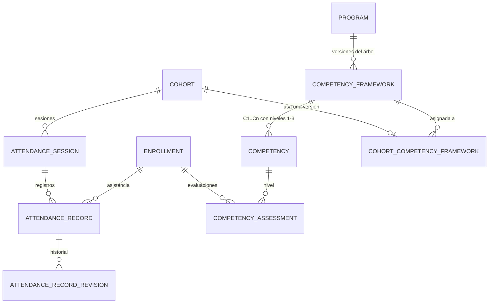

# KAN-55 / KAN-57 · Modelo de datos de asistencia y competencias

**EN summary:** PostgreSQL tables, API and tests for attendance (KAN-55, PF2-EDU-02) and versioned competency trees with level 1–3 assessments (KAN-57, PF2-EDU-04). Backend only; the UI wiring is PF2-EDU-02-T03 / PF2-EDU-04-T03 (Anas). Synthetic data only.

## Fuentes revisadas antes de diseñar

| Fuente | Qué fija |
|---|---|
| Jira KAN-55 (T01) | `AttendanceSession` y `AttendanceRecord` con `duration_fraction`, modalidad y justificación; correcciones auditadas; contrato `get_attendance_summary` |
| Jira KAN-57 (T02) | `CompetencyDefinition` / `RubricVersion` / `Evaluation`; árbol configurable por bootcamp; versión antigua trazable; evaluador y fecha |
| `AGENTS.md` §Attendance/Academic | Día completo = 1, mañana o tarde = 0,5; justificada separada; sin registro ≠ ausencia; docente solo en sus cohortes; todo auditado |
| `docs/reports/KAN-114-dropout-definition.md` | Variables que el modelo de abandono leerá de EDU-02/04: fracciones de sesiones celebradas, ausencias justificadas/no justificadas, `attendance_unknown_fraction`; nivel nulo ≠ nivel 0; catálogo dinámico, no columnas C1–C10 fijas |
| `docs/02-arquitectura-y-contratos.md` | Contratos `GET /cohorts/{id}/competencies` y `POST /enrollments/{id}/assessments` |
| Prototipo `src/gistar/types.ts`, `domain.ts` | Competencias con descriptores de niveles 1–3, catálogo por programa, "última evaluación publicada gana", nunca nivel 0 |

No existía un diseño de tablas cerrado, así que esta es la **propuesta** que sigue esas reglas.

## Diagrama

## Asistencia (KAN-55)

| Tabla | Clave y restricciones | Por qué |
|---|---|---|
| `attendance_session` | Única por (`cohort_id`, `session_date`, `shift`). `shift` ∈ mañana/tarde/completa; `duration_fraction` = 0,5 o 1 **forzado por CHECK** según el turno | El peso no se puede escribir mal. El servicio impide además mezclar día completo con mañana/tarde el mismo día (se contaría doble) |
| `attendance_record` | Única por (`session_id`, `enrollment_id`). CHECK: presente ⇒ modalidad y sin justificación; ausente ⇒ justificación y sin modalidad | Un solo registro vigente por persona y sesión; "presente online" y "ausente justificada" nunca se confunden |
| `attendance_record_revision` | Única por (`record_id`, `version`). Solo inserción (trigger). Motivo obligatorio desde la versión 2 | Cada corrección conserva el valor anterior, autor, fecha y motivo. El motivo no va al `audit_event` (texto libre) |

**Regla del resumen** (`GET /cohorts/{id}/attendance-summary`, contrato de `get_attendance_summary`): solo cuentan las sesiones ya celebradas; una sesión celebrada sin registro suma en `unrecorded_days` ("sin dato"), nunca como ausencia; `attendance_rate` = presente / registrado y es nulo si no hay registros. Devuelve totales por matrícula, sin nombres.

## Competencias (KAN-57)

| Tabla | Clave y restricciones | Por qué |
|---|---|---|
| `competency_framework` | Única por (`program_id`, `version`); como mucho una `publicada` por programa (índice parcial) | El árbol es por bootcamp y versionado. Publicar archiva la versión anterior, que sigue consultable |
| `competency` | Única por (`framework_id`, `codigo`); `codigo` = C1…C99; descriptores `level_1..3`. Congelada por trigger si la versión no es borrador | Los descriptores de niveles son la rúbrica de la versión: lo que se evaluó no puede cambiar después |
| `cohort_competency_framework` | PK `cohort_id`; la versión debe ser del mismo programa y estar publicada | Una cohorte nunca hereda por error el árbol de otro curso |
| `competency_assessment` | Nivel 1–3 (CHECK), evidencia obligatoria, evaluador y fecha. Solo inserción (trigger) | Historial completo; el nivel actual es la última evaluación. Sin evaluación = nulo, nunca 0 |

**Decisión de alcance:** las rúbricas por tarea/entrega (`Rubrica`, `Revision` del prototipo) pertenecen a EDU-03 (entregas, KAN-56). Aquí la "rúbrica versionada" es la versión del árbol con los descriptores de cada nivel.

## Permisos

| Permiso | Quién | Ámbito |
|---|---|---|
| `attendance.read`, `attendance.record` | docente, admin | cohorte asignada (o global para admin) |
| `competencies.read`, `competencies.configure`, `competencies.assess` | docente, admin | cohorte asignada; el árbol de un programa lo gestiona quien tenga permiso en alguna de sus cohortes |

Captación, selección, coordinación y personas coder/aspirante reciben 403. Toda escritura deja un `audit_event` con identificadores y códigos, sin texto libre.

## Puntos para validar / Open points

1. **Anas (UI):** ¿la forma de las respuestas encaja con `AttendanceModal` y las vistas de rúbricas/competencias? Cambiar nombres ahora es barato.
2. **PO:** `retraso` existe en el prototipo pero no en Jira/AGENTS.md; no se ha modelado. ¿Se necesita?
3. **PO:** ¿coordinación debe ver el resumen de asistencia (agregado con supresión) o solo el docente?
4. **PO:** la fecha "hoy" para decidir si una sesión está celebrada se toma en UTC; en Madrid puede diferir pasada la medianoche.
5. La vista de la persona coder (su propia asistencia y niveles) queda para una tarea posterior.
